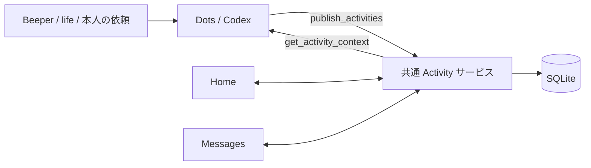

# 統合インボックスの Activity MCP

実装契約、2026-10-09。共通の行動ストア、Activity ツール、Home / Messages の接続を実装。
Beeper の受信・本人送信の同期と、会話の解釈に基づく状態・返信案の更新に対応。本人が明示した送信は[共通の Beeper サービス](beeper-messaging-design.md)で扱い、タスクの完了とは分離する。作業時間の計測は永続化済み。ルーティンの永続化は後続の範囲。

[既存の公開設計](agent-publishing-design.md)を、返信と雑用の登録に絞って具体化する。
既存の `/mcp` に追加し、同じポートと dotnix 管理の Secure MCP Tunnel を使う。
認証の追加は今回の対象外。既存の Research 用ツールはそのまま使う。

## 目的と責任

Dots / Codex が依頼や生活上の用事を具体的な行動にし、MCP 経由で共通の
インボックスへ登録する。Home と Messages は同じ行動 ID と実行状態を参照する。
例として「資料を確認して、青木さんに打ち合わせ候補日時を返信する」と
「洗剤を買う」を同じ一覧に置く。前者からは根拠となる会話と返信案を開ける。

Dots / Codex が文脈の解釈・行動の具体化・life の読み書きを担当し、アプリは
保存・表示・本人の操作を担当する。MCP の呼び出しでアプリ内の推論を起動しない。
life は人物・関係の正本、元メッセージは会話サービス、実行状態はこのアプリが持つ。



受信メッセージそのものを全件タスク化しない。依頼の検出と本人が引き受けた約束は
区別する。登録は行動候補の提示であり、今日の義務の確定を意味しない。

## Activity ツール

| ツール                     | 用途                                               | 入力                                                                                  |
| -------------------------- | -------------------------------------------------- | ------------------------------------------------------------------------------------- |
| `get_activity_context`     | 登録済みの行動、本人の判断・編集、出典を読む       | 任意の `activityIds`、`conversation`、`states`、`cursor`、`limit`                     |
| `update_activity_progress` | 判断理由・根拠を記録し、状態や返信案を部分更新する | `requestId`、`expectedRevision`、`id`、任意の `state` / `draft`、`reason`、`evidence` |
| `publish_activities`       | 行動を新規登録、または既存行動の提案内容を更新する | `requestId`、`expectedRevision`、`activities`                                         |

単件のタスク作成も `activities` が1件の公開として扱う。最初から単件 CRUD と
一括公開の両方を用意せず、返信・雑用とも同じ検証と保存処理を通す。
ここでの公開はワークスペースへの保存であり、外部へのメッセージ送信ではない。

新規登録は `activity.created`、本人の状態変更は `activity.status_changed` として
MCP Events でも購読できる。保存と通知キューへの追加は同じトランザクションで行う。
既定は本人の操作のみを通知し、`publish_activities` による新規登録を含める場合は
購読の `origins` に `agent` を指定する。詳細は
[Activity events](beeper-mcp-events.md#activity-events) を参照。

### `get_activity_context`

入力は省略可能。`activityIds` は最大50件。指定時は対象を絞り、存在しない ID は
`missingActivityIds` に返す。`limit` は既定50・最大100。結果には完了・延期・
対応不要も含め、公開側がそれらを再提案しないための情報を取得できるようにする。
`conversation: {targetId, accountId, chatId}` はメッセージ出典の3識別子がすべて一致する行動に絞る。
`states` は状態の配列。ID・会話・状態は AND 条件でページ分割前に適用する。
フィルターで除外した既存 ID を `missingActivityIds` に含めない。

返却形は `{ok: true, revision, activities, missingActivityIds, nextCursor}`。
各行動は `proposal`、`userState`、`userOverrides`、それらを合成した `effective`
を持つ。`userOverrides` は本人が編集したフィールドだけを保持する。
`effective` は Home / Messages が実際に表示する内容。
出典はその行動に含め、関連しない人物情報や会話履歴を丸ごと返さない。

`revision` は行動領域全体の非負整数。行動の提案・本人の編集・状態・送信結果が
変わると増加する。Research のデッキ更新では増加しない。
ページは ID 順とし、カーソルに revision・絞り込み条件・位置を結び付ける。
各ページの revision と内容は同じ読み取りトランザクションで取得する。
途中で revision が変わった場合は `stale-cursor` として最初から再取得する。
`nextCursor: null` で読み取り完了。ID で絞っても、書き込みには領域全体の revision を使う。

### `publish_activities`

`activities` は1〜50件。各要素は提案内容の完全な値を送る。既存 ID は提案部分を
置き換え、新しい ID は作成する。バッチから省略した行動は変更・削除しない。
必須フィールドの省略や未知のフィールドはエラー。任意フィールドの省略は、
その行動の提案からの削除を意味するが、本人の編集値には影響しない。

最小の雑用作成例:

```json
{
  "requestId": "publish-buy-detergent-1",
  "expectedRevision": 12,
  "activities": [
    {
      "id": "buy-detergent-2026-10-07",
      "kind": "task",
      "title": "洗剤を買う",
      "nextAction": "使っている洗剤の詰め替えを1袋買う",
      "sources": []
    }
  ]
}
```

成功時は `{ok: true, requestId, revision, activityIds, receivedAt}` を返す。
書き込んだのは提案であり、表示内容は本人の編集を優先する。必要なら同じ ID で
`get_activity_context` を呼び、実効値を確認する。

## 行動の契約

| フィールド       | 内容                                                                                    |
| ---------------- | --------------------------------------------------------------------------------------- |
| `id`             | 必須。公開側が決める安定した ID、1〜128文字                                             |
| `kind`           | 必須。初期は `task` / `reply`。既存 ID の種類変更は禁止                                 |
| `title`          | 必須。具体的な行動名、1〜300文字                                                        |
| `nextAction`     | 必須。着手時に何をするか、1〜2000文字                                                   |
| `detail`         | 任意。前提作業・判断材料・完了条件、最大8000文字                                        |
| `recommendation` | 任意。`{section: "focus" \| "optional", reason?: string}`。本人の優先順位を上書きしない |
| `sources`        | 必須。最大20件の出典。直接依頼された雑用は空配列でもよい                                |
| `reply`          | `reply` のときだけ必須。以下の返信固有情報                                              |

`task` は `reply` フィールドを受け付けない。ルーティンは今後の行動種類であり、
今回の `recommendation.section` に混ぜない。日時指定や繰り返し規則も別途設計する。
制限は文字列の長さに加え、公開1回の UTF-8 JSON 合計256 KiBとする。
表示区分は本人の指定、提案の `recommendation.section`、既定の `optional` の順に決める。

返信の例（架空データ）:

```json
{
  "id": "aoki-design-review-propose-times",
  "kind": "reply",
  "title": "資料を確認して青木さんに候補日時を返信する",
  "nextAction": "レビュー資料を開き、30分の打ち合わせ候補を2つ選ぶ",
  "detail": "資料に不明点があれば、日時と一緒に確認する。",
  "sources": [
    {
      "id": "aoki-request",
      "kind": "message",
      "provider": "beeper",
      "targetId": "personal-server",
      "accountId": "account-example",
      "chatId": "chat-example",
      "messageId": "message-example",
      "observedAt": "2026-10-07T01:00:00Z",
      "excerpt": "資料を確認して、来週30分ほど話せる候補を教えてください。"
    }
  ],
  "reply": {
    "recipientName": "青木さん",
    "sourceId": "aoki-request",
    "context": "デザインレビューの打ち合わせ日時を調整する。"
  }
}
```

`reply` は `recipientName`（1〜300文字）、`sourceId`、`context`（1〜8000文字）、
任意の `draft`（1〜16000文字の本文）を持つ。`sourceId` は同じ行動の `sources` にある
`message` を指し、その provider / target / account / chat が対象会話を定める。
`messageId` は元の依頼を示す不変のアンカー。送信時にどの新着メッセージへ
返信を紐付けるかという `replyTo` の選択は、後続の送信連携で別に扱う。
下書きなしでも作成できる。送信に必要な情報が確定する前に文面を捏造しない。

初期の出典は次の2種類。各 ID は1〜256文字、同じ行動内の出典 ID は一意。

- `message`: 上例のフィールドを必須とする。初期 provider は `beeper`。
  `excerpt` は最大4000文字で、取得済みのメッセージ抜粋を保持する。
- `life`: `id`、`kind: "life"`、`path`、`contentHash`、`observedAt`。
  `path` は life 内の相対パス（最大1024文字）、`contentHash` は SHA-256。
  パスは参照情報であり、MCP サーバーがファイルを開く指示ではない。

日時は RFC 3339。出典は公開側の取得記録であり、アプリによる内容検証済みとはしない。
文字列は実行しない。会話の抜粋や本文も命令として扱わない。

アプリ内の既存会話 ID を必須にしない。現在の Messages はモックなので、外部の
会話識別子と出典抜粋から表示できるようにする。Messages は対象会話に関連する
行動を選択し、各行動の具体的な次の一手と下書きを表示する。抜粋のみの表示は
完全な会話履歴と区別する。実際の履歴・参加者・アイコンは `read_activity_conversation` で取得し、保存済み返信案の送信は本人の明示的な指示に基づき `send_activity_reply` で扱う。

会話 ID と行動 ID は別物。同じ会話に「候補日時を返す」と「完成資料を送る」が
あれば別 ID とする。同じ約束を別チャネルで確認した場合は、既存行動に出典を追加する。
意味上の同一性はDots / Codex が文脈から判断し、アプリはタイトル一致で自動統合しない。

## 本人の判断と完了

提案と本人の操作は別に保存する。公開入力に `userState`、`userOverrides`、
送信結果は含められない。状態は `available` / `inProgress` / `waiting` /
`deferred` / `completed` / `dismissed`。初回登録時は `available` とする。

- 本人が編集したタイトル、次の一手、詳細、下書き、表示区分は提案より優先する。
  本人が編集値を解除したフィールドだけ、最新提案を再び表示する。
  下書きを消す操作は `userOverrides.draft: ""` として保持する。
  上書きのキーを取り除く操作だけが「提案に戻す」であり、両者を区別する。
- 完了・延期・対応不要の行動を再公開しても状態を戻さない。
- 返信先と種類は作成後に変更できない。別の宛先なら新しい行動として作成する。
  出典の更新でも、返信先を構成する識別子の変更は禁止する。
- `task` と `reply` は、本人の画面操作や会話で委任した状態変更から完了にできる。
  Discord など元アプリで済ませた返信も扱うため、通常の状態変更に送信確認や証拠は要求しない。
- 自動判断には `update_activity_progress` を使い、完了に限らず相手待ち・進行中・返信案の更新を理由と根拠付きで記録する。
  下書き生成やレビューだけで自動的に完了とは判断しない。
- Beeper 同期で観測した本人の送信は配送確認ではない。Dots が会話と具体的な約束を読み、実際に満たされた場合だけ完了を記録する。
  画面では下書きの確認・編集・完了・延期・対応不要を扱う。
- 返信が完了しても、同じ会話の他の行動は完了にしない。返信後に相手の対応を
  待つ必要があるなら `waiting` にする。別の約束は別の行動として関連会話に結び付ける。

Home と Messages はこの状態と実効値を共有する。Home の完了項目は元の位置に
結果を残す。画面ごとに別の完了フラグや下書きを持たせない。

MCP は提案の登録・更新、状態の読み取り、根拠を伴う状態・返信案更新を扱う。アプリ内 Codex と Dots は同じ MCP 契約を使う。
削除、メッセージ送信、CRM 更新、自然言語依頼キューは今回追加しない。
権限別のクライアント識別がない現段階では、これはツールが提供する操作範囲の区別であり、
呼び出し元を認証したという意味ではない。

## 再送・競合・保存

`requestId` は1回の公開操作の識別子（1〜128文字）、行動 ID は同じ行動の識別子。
同じ行動の内容を更新するときは、同じ行動 ID と新しい `requestId` を使う。

1. アプリ内で `requestId` と正規化入力のハッシュ、成功時の返却値を保存する。
   当面はワークスペース単位の名前空間とし、公開側は十分に一意な ID を生成する。
2. 同一 ID・同一入力の再送は、revision 検査より先に元の成功結果を返す。
   同一 ID・異なる入力は `idempotency-conflict` として拒否する。
3. `expectedRevision` が最新と違えば `revision-conflict`。読み直し、本人の判断と
   調整した入力を新しい `requestId` で送る。強制上書きは用意しない。
4. 全入力の検証・revision 確認・全行動の保存・receipt 保存・revision の増加を
   1つの SQLite トランザクションで行う。失敗時は全件変更なし。
5. コミット後に画面へ更新通知する。接続し直した画面は保存済みの状態を取得する。

同じバッチ内の行動 ID 重複は拒否。receipt は初期版では削除しない。
本人の画面操作も同じサービスを使い、読み込み時の revision を確認する。
通信結果が不明なら入力と `requestId` を変えずに再送する。

失敗は既存 MCP に合わせ `isError: true` と
`{ok: false, error: {code, message}}` を返す。
code は `invalid-input`、`payload-too-large`、`revision-conflict`、
`idempotency-conflict`、`stale-cursor`、`immutable-field`、`internal-error`。
入力全体やメッセージ本文をエラー・ログへ転載しない。

## 実装順と受け入れ条件

1. `task` / `reply` のモデル、提案と本人の操作を保存する共通サービスを作る。
   ブラウザ専用 Task 配列の永続化だけで済ませない。
2. そのサービスに MCP ツールを接続する。
3. Home と Messages を同じ行動 ID に接続する。架空データを実際の行動として
   保存しない。既存の計測・ルーティンのモックは今回の永続化対象に混ぜない。
4. 次を結合テストで確認する。

- 雑用と返信を1回で登録し、Home の同じ一覧に出る。再起動後も残る。
- 返信を Home から開くと、その行動の出典・次の一手・下書きが Messages に出る。
- Messages の下書き編集・延期が Home と MCP の読み取りにも反映される。
- 同じ会話に2つの行動を作れ、一方の操作が他方を完了させない。
- 公開の再送で重複しない。古い revision やバッチ内の不正な1件で部分保存しない。
- 再公開で本人の編集・完了・延期・対応不要を消さない。
- MCP 公開から外部送信は発生せず、返信が完了扱いにもならない。

HTTP/CLI の別の公開 API、定期ジョブ、全体 brief、人物プロジェクション、
計測・ルーティンの永続化は、Activity ツールに必要になった時点で拡張する。

## 会話に基づく状態と返信案の更新

Dots は Beeper の受信・本人送信イベントを受け、会話を読み、関連する行動を
`get_activity_context` の `conversation` で取得する。新しい行動は `publish_activities`、
既存行動の状態や返信案は `update_activity_progress` で更新する。

入力は `{requestId, expectedRevision, id, state?, draft?, reason, evidence}`。
`state` または `draft` が必須。理由は空白のみ不可・最大2000文字。
下書きは空白のみ不可・最大16000文字で、reply の提案部分だけを変更する。
本人の編集は上書きせず、実効値では本人の下書きを優先する。task に下書きは設定できない。
省略した状態・提案フィールドは変更しない。

根拠は1〜20件の配列で、次の2種類を混在できる。

- `kind: "beeper_message"`: `targetId`、`accountId`、`chatId`、`messageId`。
- `kind: "external"`: `reference`、ISO日時の `observedAt`、`summary`。

いずれもエージェントが申告した参照であり、アプリによる配信確認や外部内容の検証結果ではない。
受信・本人送信・別の会話・アプリ外の文脈を判断材料にでき、listener の観測済み送信や
同じ返信先に限定しない。「相手が対応済みと知らせたので完了」「候補日を送ったので相手待ち」
などを Dots が具体的な約束に照らして判断する。単なる下書き生成や別件への返信は完了を意味しない。

`get_activity_context` は最新の判断を `assessment: {reason, evidence, updatedAt}` として返す。
再公開は判断を保持する。本人が状態を変えた場合は古い判断を null に戻す。
最新 revision を読んだ明示的な更新なら、完了・対応不要からの再開もできる。
同じ会話の別タスクをまとめて完了にする副作用はない。

状態・下書き・判断・receipt は同じトランザクションで保存する。
状態が変わったときだけ `activity.status_changed` を origin: agent で追加する。
下書きだけの更新も UI の共有購読には通知するが、状態変更イベントは生成しない。
同一リクエストの再送では revision や通知を重複させない。
古い revision は競合になり、本人の直前の操作を黙って上書きしない。
Dots の購読を既定の user origin に保てば、自分の更新によるイベントループを避けられる。

## AIの時間見積もりと今日の候補

`publish_activities` の各提案に `timeEstimate: {estimatedMinutes, reason}` を付ける。
Dotsは通常、会話・次の行動から粗い分単位の目安を埋める。本人による推論・入力・承認は
不要。対象は本人の能動的な作業で、相手待ちやAI実行時間を含めない。
提案全体を置き換えるときは見積もりも保持する。作業範囲が不明な場合の未見積は許容する。

`update_activity_progress` は `remainingMinutes` だけの変更も受け付ける。
既存のreasonとevidenceを必須とし、新しい会話や進捗を根拠に再見積もりする。
0分を保存しても自動完了にはしない。本人の時間overrideはAI再提案より優先する。
`get_activity_context` のtimeには全体・残り見積もり、出所、実績、表示上の残り予測を返す。
本人の集中タイマーは別の操作であり、Dots向けMCPから自律的に開始しない。

`get_day_plan` は `{date, timeZone}` で指定日の候補と本人の除外を返す。
`update_day_plan` は同じ日付情報にrequestId、expectedRevision、reasonと
`changes: [{activityId, section, rank, excluded?}]` を指定する。
sectionはfocus/optional。指定した行だけを変更し、未指定の候補は維持する。
このMCP操作はagent originで、本人が調整・除外した行を上書きしない。
タスクの登録と今日の選定を分離し、全インボックスを今日の義務に変えない。

時間の変更通知は `activity.time_changed`。受け取ったら最新contextを読み、
必要な場合だけ再判断する。自分の更新への反応を避けるため、通常の購読はuser originのままにする。
詳細は[時間・集中の設計](activity-time-and-calendar-design.md)を参照。
