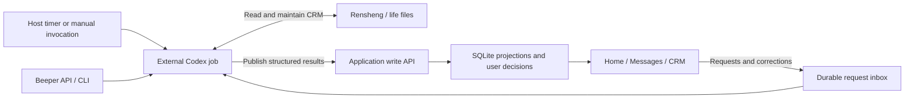

# External Codex publishing into the workspace

Proposal, 2026-09-28. No endpoints, timers, or inference jobs in this document
have been implemented. This supersedes the earlier proposal for app-managed
inference and an application-owned life filesystem adapter.

## Responsibility

External Codex reads Beeper and the life filesystem, reasons about them, and
maintains life under its existing Rensheng conventions. life remains the CRM
source of truth. The workspace accepts structured results, persists and displays
them, and records user decisions and requests. It does not need a new LLM loop,
CRM compiler, or Markdown editing engine.



The existing Research chat can remain as-is. This design does not require
removing that feature or putting its runtime in charge of CRM automation.
Deterministic Beeper reads, live UI updates, and confirmed sends are ordinary
application integration code; they do not imply app-owned inference.

## What gbrain actually does

Inspected revision: `e78f1c38b947b053f3a46881340f74f316be855a`.

- Its [cron convention](https://github.com/garrytan/gbrain/blob/e78f1c38b947b053f3a46881340f74f316be855a/skills/conventions/cron-via-minions.md)
  assigns scheduling to the host. It explicitly describes a native cron
  scheduler inside `jobs work` as not yet shipped.
- [Minions workers](https://github.com/garrytan/gbrain/blob/e78f1c38b947b053f3a46881340f74f316be855a/src/core/minions/worker.ts)
  handle durable execution, leases and retries. Job idempotency and prevention
  of overlapping runs are separate concerns.
- [Autopilot](https://github.com/garrytan/gbrain/blob/e78f1c38b947b053f3a46881340f74f316be855a/src/commands/autopilot.ts)
  is a maintenance daemon, not a ready-made external Codex scheduler. The
  built-in [subagent handler](https://github.com/garrytan/gbrain/blob/e78f1c38b947b053f3a46881340f74f316be855a/src/core/minions/handlers/subagent.ts)
  uses gbrain's own model/tool execution.
- Its [page write operation](https://github.com/garrytan/gbrain/blob/e78f1c38b947b053f3a46881340f74f316be855a/src/core/ops/pages.ts)
  uses request receipts, expected revisions and transactional writes. These are
  useful patterns for publishing into this app without importing its entire stack.

## Scheduling proposal

Use one external systemd timer and oneshot service, or the existing host scheduler
if one already owns this workflow. Do not create schedules during research.
Start with a morning brief and periodic daytime refresh; exact cadence and job
timeout are deployment choices, not established product requirements.

The runner sets an explicit working directory and `CODEX_HOME`, prevents
concurrent runs, reads the app context revision, then invokes Codex to inspect
sources and prepare a result. It publishes through the application API and keeps
a private result file until acknowledgment so a network retry need not repeat
inference. Do not put credentials in prompts or command arguments.

Use separate identifiers for the scheduled occurrence and publish attempt. A
retry of an unchanged result keeps its `runId`; regeneration after a conflict
uses a new `runId`. Host logs expose started, finished and failed runs without
dumping messages. The UI can show the last successful publication and source
freshness; it should retain the previous good result when a new run fails.

Beeper events can later mark work dirty and coalesce a wake-up. Do not start one
Codex process per message. Natural-language requests can use the same external
worker path; a future wake-up signal should only notify that worker, not execute
browser-supplied shell text.

## Write interface

Start with HTTP and a small CLI wrapper that accepts JSON from a file/stdin.
Add an MCP wrapper only if useful for tool discovery; it must call the same
validated service. HTTP, CLI and MCP are access methods, not three state stores.
Avoid direct SQLite writes and an arbitrary SQL, shell or filesystem tool.

Proposed first contract, keeping the repository's camelCase JSON convention:

| Method and path            | Caller                | Purpose                                                                 | Success                   |
| -------------------------- | --------------------- | ----------------------------------------------------------------------- | ------------------------- |
| `GET /api/agent-context`   | Agent credential      | Read revision, current projections, user decisions and pending requests | `200`                     |
| `POST /api/agent-results`  | Agent credential      | Atomically publish a validated result and complete referenced requests  | `201`; exact replay `200` |
| `POST /api/agent-requests` | Owner browser session | Persist a natural-language request or a requested life correction       | `201`; exact replay `200` |

Browser snapshot reads use the same application service under owner session
authentication. An optional `GET /api/agent-results/{runId}` receipt endpoint can
be added if exact POST replay is insufficient. No public API version prefix is
needed for this first coordinated client/server contract.

The agent credential is limited to context reads and result publication. It must
not approve a send, change login settings, or mark user decisions on the user's
behalf. The existing session, Tailscale and Origin middleware does not accept
this authentication flow today. Implement a narrowly scoped agent route branch
that verifies its own credential; do not add these paths as unauthenticated
exceptions or spoof a Tailscale identity. Use loopback locally, TLS remotely.

### Result shape

Illustrative payload, with fictional data:

```json
{
  "runId": "morning-2026-09-29-attempt-1",
  "jobKey": "daily-brief",
  "expectedRevision": 42,
  "generatedAt": "2026-09-28T23:00:00Z",
  "sourceRefs": [
    {
      "id": "life-person-example",
      "kind": "life",
      "path": "people/example.md",
      "contentHash": "sha256:example",
      "observedAt": "2026-09-28T22:59:00Z"
    }
  ],
  "brief": {
    "date": "2026-09-29",
    "timeZone": "Asia/Tokyo",
    "text": "Start with the meeting reply.",
    "evidenceIds": ["life-person-example"]
  },
  "people": [
    {
      "id": "person-example",
      "name": "Example Person",
      "context": "Discussing the next meeting.",
      "evidenceIds": ["life-person-example"]
    }
  ],
  "activities": [],
  "replyDrafts": [],
  "retractions": [],
  "completedRequests": []
}
```

`runId` and `jobKey` are required bounded strings; `expectedRevision` is a
nonnegative integer from the last context read. All timestamps are RFC 3339.
The server stamps `receivedAt` and authenticated publisher identity itself.
Dates used for the home brief include an explicit timezone.

People/activities/drafts are upserts with stable IDs, not position-based IDs or
display names. People are projections of life, not independently maintained CRM
facts. Activities use the typed contract below, with a title, references and
evidence IDs. Drafts include canonical target/account/chat IDs, reply target,
source message revision and candidate bodies/styles. Beeper evidence includes
target/account/chat/message IDs and observation time; life evidence includes a
relative path and content hash. A Git revision alone does not describe uncommitted
life edits. Source references are data, never filesystem access instructions.

The app validates structure, references, bounds and permissions; it does not
infer whether a CRM fact is true. Publisher-supplied evidence is provenance, not
proof that the app independently verified the original file or conversation.

Omitted `brief` leaves the brief unchanged; empty arrays perform no upserts.
Omission never deletes an existing item. Explicit typed retractions can withdraw
agent suggestions but cannot delete user-owned decisions. Reject unsupported
fields and nulls in this coordinated first version. Agree payload size, per-array
limits and bounded context pagination when implementing; do not accept unbounded
history or attachments through this endpoint.

### Atomic publication and conflicts

1. Scope receipts to authenticated publisher plus `runId`. Store a canonical
   payload hash. A replay with the same payload returns the original receipt;
   the same key with different content returns `409 idempotency_conflict`.
2. Check replay before checking the expected revision. A successful retry must
   still work after unrelated later UI changes.
3. Validate the full result, check `expectedRevision`, write projections and the
   receipt, and increment the context revision in one SQLite transaction.
   A concurrent publish or user edit yields `409 revision_conflict` and no writes.
4. User edits, dismissals, completions and selections live separately from agent
   suggestions. A new proposal cannot revive a dismissed action or replace a
   user-edited draft. Context reads expose those decisions to Codex.
5. Emit a browser update only after commit. On reconnect, fetch a snapshot;
   notifications are not the source of truth. A failed publication leaves the
   previous brief intact.

Return `{runId, revision, receivedAt}` as the receipt. Keep deduplication receipts
for the MVP's lifetime; any future pruning must define a retry horizon first.
Retry transient transport failures with the exact payload and key. Conflicts
require a fresh context read and reconciliation, not blind retry.

Use a small stable error envelope such as
`{code, message, details, requestId}`: `400` malformed JSON, `401` invalid agent
credential, `403` forbidden operation, `409` conflicts, `413` oversized payload,
`422` invalid result structure, `429` throttling, and `5xx` transient server faults.
No partial successes. This is a new machine API; it need not refactor unrelated
existing UI error contracts.

## Returning user intent to Codex

The app must also expose what the user did. Otherwise the next scheduled run
cannot distinguish a stale suggestion from a deliberate dismissal or correction.

`POST /api/agent-requests` accepts a stable client `requestId`, a kind such as
`refresh`, `reply-draft`, or `crm-edit`, an optional entity ID/source revision,
and the user's text or requested edit. Persist before acknowledging. Repeated
IDs with identical bodies return the same request; mismatches return `409`.

A result links each completed request using
`completedRequests: [{requestId, sourceRefIds}]`. All source references must exist
in the publication; a `crm-edit` completion requires a life reference with the
resulting content hash. Reject completion of unknown or already cancelled
requests. This validates the claimed provenance link, not the file contents
independently.

A person-note edit appears as pending while external Codex applies it to life.
It becomes confirmed only after publication references that request and supplies
the resulting source revision. Failures keep the previous confirmed projection
and the pending request visible. Do not label an app-only edit as already saved
to life. Single-worker execution avoids requiring a job lease API for this MVP.

life changes and app publication are not one transaction. If the process stops
between them, the next run re-reads life and checks the request's outcome before
applying it again. Prefer desired-state edits over blind append operations and
preserve request provenance where the life workflow permits it.

Actual message sending remains a separate, revision-bound user command. Publishing
a draft or marking an agent request complete cannot send a message. Send results
can be exposed in the next agent context for Codex to update life.

## First useful slice

Implement context read and result publish, persist them, and render a published
brief plus a mixed activity list: weight entry, a simple optional task, routine
steps and a reply linked to published life context. Prove duplicate replay,
conflict handling, reload persistence and preservation
of user decisions with fixture data. Then run one external Codex job manually
before installing a timer. Add the request inbox when introducing on-demand
generation or CRM editing. This order gives the agent somewhere to write before
building automation around it.

The [Beeper Copilot captures](references/beeper-copilot/README.md) provide the UI
reference for those published results: conversation list, conversation body,
person context, evidence chips, reply candidates and explicit review.

## One activity list, different execution surfaces

Home should unify what the user needs to do, while preserving the right controls
for each activity. A shared task abstraction does not imply a universal checkbox
or a universal chat card. Activity ordering, deferral and visibility are shared;
execution and completion are domain-specific.

| Activity kind | Inline or expanded Home UI                                            | Completion evidence                                         |
| ------------- | --------------------------------------------------------------------- | ----------------------------------------------------------- |
| `task`        | Concise title, optional detail, completion control                    | User marks it complete                                      |
| `measurement` | Weight number field, unit, last recorded value/time, Save             | A measurement record is saved                               |
| `reply`       | Person, latest relevant message, reason to reply, draft editor/review | Send is confirmed; a larger exchange may remain waiting     |
| `routine`     | Ordered child activities and progress                                 | Required children complete, or an explicit skip is recorded |

Use common fields such as `id`, `title`, `kind`, `evidenceIds`, `personId`,
`parentId`, `occurrenceKey`, and optional recommendation/order metadata. User
state (available, in progress, waiting, deferred, completed or skipped) is stored
separately from Codex's recommendation. Each kind has a validated payload and a
fixed application renderer; do not accept agent-generated executable UI or HTML.

`routine` and `optional` in the current Home sections are grouping/priority
choices, not exclusive UI types. A weight activity can be a morning routine step;
a reply can be optional today. A routine groups child activities rather than
duplicating their records. Home and Messages refer to the same reply activity ID,
so editing or finishing it in either surface is immediately consistent.

For example, an illustrative measurement activity published by Codex:

```json
{
  "id": "weight-2026-09-29",
  "kind": "measurement",
  "title": "Log weight",
  "parentId": "morning-2026-09-29",
  "occurrenceKey": "2026-09-29@Asia/Tokyo",
  "payload": { "metric": "weight", "unit": "kg" },
  "evidenceIds": []
}
```

Codex chooses or recommends the activity; the user supplies the measured number.
The app saves the observation and its occurrence time without invoking inference.
Corrections preserve the observation history. Completion must reflect that save,
not merely a checked box. The agent can read this execution evidence on its next
run and maintain life accordingly; the app does not need to infer health advice.

Recurring activities need stable per-occurrence IDs: publishing tomorrow's
routine must not reopen today's completed one. Missing time slots are valid;
the user explicitly wants flexible daily ordering rather than a strict calendar.
A real appointment can still retain its explicit date/time.

Reply completion follows the confirmed send state, not draft generation, review
or merely pressing Send. A conversation can contain multiple distinct commitments;
Codex determines those relationships from sources. The application stores explicit
links and user choices without deciding that one reply resolves every commitment.

The resulting Home can place a weight input, a routine's next step, a reply
preview and a simple task together. Use a compact shared outer row and expand
the relevant controls in place; detailed conversation/CRM views remain available.
Natural-language entry creates an external-agent request, while direct numeric
entry, checkboxes and draft edits remain immediate deterministic UI operations.

## Routine execution and workstyle learning

The user wants to import ideal routines from life, track their execution in this
app, and use external Codex analysis to develop a workable personal workstyle.
This adds explicit execution analytics to the earlier reference-only routine
concept; it does not imply that all ideals are already practiced or due daily.

Keep three levels distinct:

1. **Routine definition:** life source, stable ID, definition revision, purpose,
   trigger, steps, and completion rule. Codex publishes a structured projection.
2. **Trial/activation:** which version is currently being tried, applicable days
   or situations, and the chosen scope. Importing an ideal into the catalog does
   not silently activate every step as a daily obligation.
3. **Occurrence and observations:** the actual applicable occasion, its frozen
   definition revision, user actions, recorded values, skips, and corrections.
   The application is the source for execution history; life links to it rather
   than maintaining a second completion ledger.

An approved routine definition can be instantiated deterministically by the app
on its recurrence or a user action such as starting/ending work. Codex need not
run every time a routine appears. Situational occurrences should come from an
explicit trigger or confirmed source, not an assumed event inferred by the UI.
Keep occurrence identity stable across delayed cron runs and retries. Do not
turn unfinished instances into an ever-growing daily backlog automatically.

Proposed operating loop:

- **Import:** Codex reads life and publishes a routine catalog with sources and
  revisions. Show what is already active and what remains an ideal/candidate.
- **Try:** choose a small set and a review window, for example one or two weeks.
  These durations and counts are starting suggestions, not fixed app rules.
- **Execute:** Home presents due/applicable occurrences with kind-specific UI.
  Save completion evidence as part of the natural action: entering a value,
  sending a reply, writing a resumption note, or completing a task. Optional
  friction feedback can be one tap; reporting a reason is not required.
- **Review:** the application calculates counts from recorded events. External
  Codex reads the counts and underlying evidence, relates them to life context,
  and publishes a short review with observations, uncertainties and proposals.
- **Adjust:** the user adopts, modifies or rejects a proposal. Codex updates the
  ideal/working procedure in life and publishes a new definition revision.
  Historical occurrences retain their previous revision and completion rule.

A scheduled daily job can refresh the overview, while a weekly job reviews the
experiment. Neither creates additional inference inside the app. The publishing
contract will need versioned routine definitions and review artifacts alongside
activities; context reads must expose execution observations and aggregate counts.
Those are deterministic data contracts, not a new agent runtime.

### Metrics that preserve meaning

Show counts and denominators next to percentages. For each routine revision and
review window, report completed, partially completed, explicitly skipped,
deferred, not applicable, and unrecorded occurrences separately. A past due item
without an observation remains unrecorded, not verified non-execution.

A useful default is **recorded attainment = completed / applicable planned
occurrences**, accompanied by observation coverage. For example, 5 completed,
1 explicitly skipped and 1 unrecorded out of 7 applicable occasions yields 5/7
recorded attainment and 6/7 observed outcomes. It does not prove that the person
failed to act on the unrecorded occasion. If a resolved-outcome rate is also
shown, label its different denominator explicitly. Keep skipped occasions in
the planned denominator; exclude not-applicable ones with a recorded reason and
retain plan revisions so exclusions cannot silently rewrite prior performance.

Do not count a routine parent and every child as independent equivalent successes
in a global percentage. Analyze routines and steps at separate levels. Optional
ideas that were never scheduled/adopted do not belong in the planned denominator.
Explicitly record reduced/partial completion without silently calling it full
completion. Measurement adherence is about saving a measurement, not moving the
number in a preferred direction; reply counts do not measure relationship quality.

Attainment alone cannot establish usefulness. Add lightweight, optional feedback
on effort and whether a routine helped, plus domain-specific evidence such as a
resumption note being available next time. Compare versions over named periods
and show sample sizes. Codex can suggest one change to try next, but sparse
observations or coincident changes do not establish a causal improvement.

The review should answer: what was practical, where execution stopped, what was
useful, and what small change is worth trying next. Good outcomes can include
shortening, reducing frequency, changing the trigger, or retiring a routine.
Do not optimize a single global completion score at the expense of the purpose
of the work or the user's freedom to change the plan.
