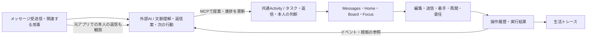
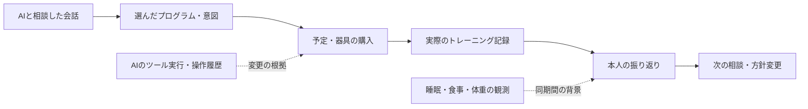
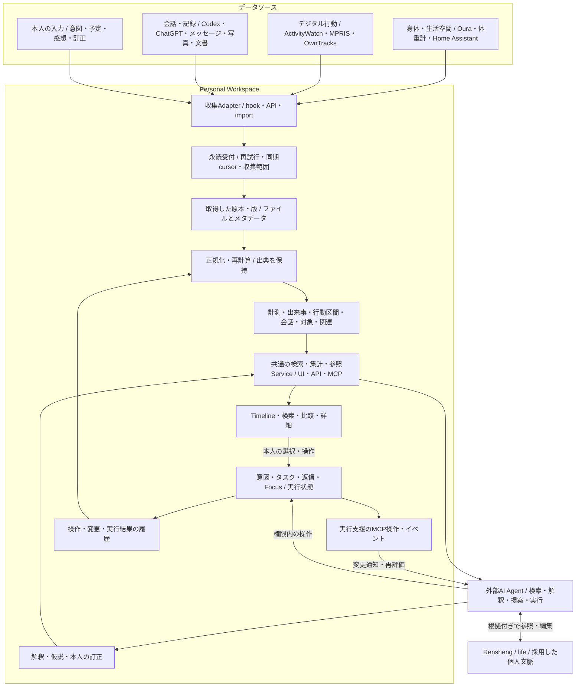
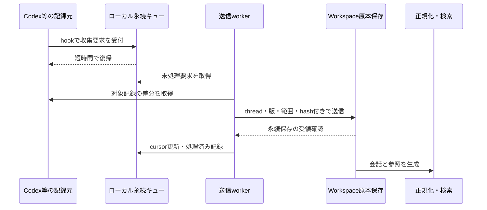

# Personal Workspaceのビジョンとアーキテクチャ

2026-10-11。生活全体のトレースと、外部AIによる返信・実行支援を主軸にした目標設計。図は目指す構成であり、実装状況は末尾に分けて示す。

## ビジョン

**自分、生活環境、関わった人やAIについて、何を見聞きし、何を考え、何を意図し、何をして、その後どうなったかをたどれるようにする。**

Personal Workspaceは、その記録と関係性を集め、探索・理解・実行・振り返りを支える場所を目指す。AIとの相談、AIが代理で行った操作も生活の出来事に含める。身体、場所、PC操作、会話、写真、文書、予定、タスクを、別々のサービスに閉じた履歴のままにしない。

**外部AIを使ったメッセージ返信と実行機能のサポートも、生活トレースと並ぶ主機能とする。** 受信した依頼の把握、返信案、次の行動への分解、着手・再開、委任、進捗の追跡までを支える。「実行機能」はAIのツール実行だけを指さず、本人が判断・着手・継続する負担を減らす意味を含む。生活データの収集が完成する前から日常で使える機能として育てる。

「人間OpenTelemetry」はこの世界観の比喩であり、OpenTelemetry自体の採用要件ではない。生活の出来事は同時並行し、境界や理由も曖昧なので、一日の行動を単一の親子spanに押し込めない。

生活改善は重要な用途の一つだが、記録は改善提案やタスクに変換されなくても価値を持つ。思い出す、判断の経緯に戻る、AIへ文脈を引き継ぐ、変化を知ることも目的に含める。記録された発言は思考全体ではなく、計測されなかった時間は不明として扱う。

## 目指す体験

### 外部AIと返信・行動を進める

外部agentがメッセージの受送信と関連する用事を追い、返信案や実行可能な次の行動をWorkspaceへ反映する。本人はMessagesで文脈を見ながら返信を編集・送信し、Homeで着手候補を選び、Boardで委任や進捗を確認し、Focusで作業を進める。後回し、相手待ち、再開も扱い、本人が毎回タスクを整理し直す負担を減らす。

返信と普通のタスクは共通の状態を持ち、本人の編集や決定をagentの再提案で消さない。元アプリで本人が返信した場合も観測し、外部agentが根拠付きで進捗を更新できる。送信成功と用事の完了は別であり、本人はアプリ外で済ませた用事を手動で完了できる。MCP操作とイベントが実行支援を直接つなぎ、原本の収集・索引生成の完了を待つ設計にはしない。

### 生活とAIの経緯をたどる

例えば「筋トレを始めようと思った経緯と、続けてみてどうだったか」を開くと、次の流れを出典付きでたどれる。

この矢印は一律に因果関係を意味しない。本人が明示した理由、システムが記録した参照、時間的な近接、AIが推定した関連を区別し、根拠と訂正を残す。会話中の提案を本人の決定へ、予定を実施済みの活動へ自動変換しない。

## 全体構成

図中の箱は責務の分離であり、個別サービスの立ち上げを意味しない。初期は既存アプリ、SQLite、私有ファイル領域、収集workerで始める。Home Assistant等には専門の収集・制御を任せ、Workspaceへ参照可能な記録を取り込む。Grafanaは必要な時系列分析を補う選択肢で、生活トレース全体のUIを担う必須要素ではない。

## 保持する情報と境界

| 層             | 保持するもの                                       | 設計上の約束                                                    |
| -------------- | -------------------------------------------------- | --------------------------------------------------------------- |
| 取得原本       | API応答、会話JSONL、export、利用可能な添付、元の版 | 要約で置き換えない。取得範囲・欠落・保持方針を記録する          |
| 正規化した記録 | 計測値、出来事、時間区間、会話message、対象の参照  | source ID、原本の位置、時刻・単位を保持し、再計算可能にする     |
| 関連           | 会話と意図、操作と結果、活動と場所など             | 明示参照・本人確認・推定を区別。推定には根拠と処理versionを持つ |
| 解釈           | VLM注釈、行動分類、仮説、要約                      | 原本と分離。新しい解釈で古い根拠や本人の訂正を消さない          |
| 意図と実行     | タスク、返信、予定、Focus、AIへの委任              | 予定・試行・実際の結果を区別。既存の実行状態を二重管理しない    |
| 個人文脈       | 選好、採用した目標、人物関係、手順                 | lifeを正本とする方針を維持し、元会話へリンクする                |

全てを一つの汎用event表へ押し込めず、計測・会話・実行にはそれぞれのモデルを使う。共通化するのは時間、対象、出典、関連、検索の入口。対象間の関連も、初期はSQLiteの参照表で表現でき、グラフDBを先に導入しない。

発生時刻、観測時刻、取り込み時刻、時刻の精度を区別する。データソースが停止した時間を「活動がなかった」と解釈しない。同じ出来事を複数ソースが記録した場合も、元の観測を残し、統合した表示・推定を派生させる。

## AIもトレースの対象にする

AIは解釈を行う利用者であると同時に、生活に影響する行為者でもある。会話・判断材料・ツール実行・変更結果を結び付け、どのagentが何を提案し、何を実行したかをたどれるようにする。

hookは収集のきっかけであり、唯一の配送保証にしない。起動時・定期走査で取りこぼしを回収し、元ログが削除されるまでに取得する。実行中のJSONL末尾も原本のbytesは保存し、未完行の正規化だけを保留する。ChatGPTは公式exportから始め、live同期は別途検証する。

原本を保存することと、全てのモデルへ開示することは分ける。agentは必要な範囲を検索・参照し、検索本文の秘匿化と原本へのアクセス権を別々に扱う。収集の停止・保持期間・削除もソース単位で管理する。「全生活」は対象領域の広さを意味し、取得できない情報まで完全に記録できるという保証ではない。

現在のauditはアプリ内変更、通信ログはMCP書き込み等を扱い、全会話の保管庫ではない。会話原本の収集を追加しても、MCP読み取りを記録しない既存方針は変更しない。詳細は[会話収集設計](ai-conversation-ingestion-design.md)を参照。

## 参考プロジェクトとの関係

| プロジェクト    | 参考にする点                                     | Workspaceでつなぐ対象            |
| --------------- | ------------------------------------------------ | -------------------------------- |
| Aurboda         | 異種計測の正規化、時間区間、分析インターフェース | 身体・環境・デジタル活動         |
| Timelinize      | 原記録のアーカイブ、対象間の関係、履歴探索       | 会話・写真・文書と生活の出来事   |
| gbrain          | AI会話の取り込み、版管理、検索、記憶抽出         | AIとの相談・判断・代理操作の経緯 |
| Rensheng / life | 出典のある個人文脈と外部agentによる整理          | 記録から採用した選好・目標・手順 |

機能を全て移植する方針ではない。Workspace自身が持つ実行・auditと、生活記録を共通の時間・出典・関連からたどれることを中心に、必要な実装を選ぶ。ライセンスと選択移植の詳細は[生活観測設計](personal-observability-design.md)と[会話収集設計](ai-conversation-ingestion-design.md)にまとめる。

## 現状と実装順

返信・実行支援は継続して開発する主機能であり、以下の生活トレース導入が完了するまで後回しにしない。既存の外部AI連携・返信・着手支援を維持しながら、そこで生まれる意図と結果を新しい観測ソースに結び付ける。

| 状態                | 範囲                                                                                              |
| ------------------- | ------------------------------------------------------------------------------------------------- |
| Workspaceで実装済み | 永続タスク・返信、Beeper連携、Focus、activity audit、MCP書き込み等の通信履歴、アプリ内Codex会話   |
| 別途設定済み        | dotnixのThinkPad向けActivityWatch・MPRIS収集設定。実機稼働とWorkspaceへの取り込みは別途確認が必要 |
| Prototype           | Vitals、Journalの身体記録、ルーティン。永続的な健康データ収集として扱わない                       |
| 今後の実装          | 外部原本の収集、生活Timeline、横断検索・関連、AI会話全量取り込み、life連携、改善の評価            |

1. **収集と受領確認**：既存auditを参照し、Codex原本と一つの生活ソースを取り込む。再送・途中停止・更新時に欠落や二重計上がないことを確認する。
2. **一日のトレース**：会話・PC活動・Focus・操作を同じ時間軸で表示。各項目から原本へ戻れ、未収集の範囲も分かるようにする。
3. **出来事をまたぐ参照**：thread・task・execution等の確実なIDから関連付け、AIが推定する関連は別に提示する。生活の領域はOura、位置、食事、筋トレ等へ広げる。
4. **解釈と文脈の引き継ぎ**：必要な場面でVLMや会話要約を追加し、原本を再処理できる状態を保つ。採用した情報をlifeへ反映する。
5. **実行・振り返り・改善**：記録をもとに提案し、実施と後日の観測を比較する。閲覧や振り返りだけでも利用できる状態を維持する。

最初の到達点は、**「昨日AIと話して決めたこと、その後の作業、実行した変更を、欠けた情報も含めて出典付きでたどれる」**こと。データソース数だけでなく、記録の連続性、参照の正確さ、振り返りに役立つかで確かめる。

## 詳細設計・調査

- [Personal Data Vault：AW＋タスクの日次レポートとRedditの利用例](personal-data-vault-research.md)
- [生活観測とauditの統合設計](personal-observability-design.md)
- [Codex・ChatGPT会話収集設計](ai-conversation-ingestion-design.md)
- [Aurbodaのデータソース調査](aurboda-data-sources-research.md)
- [Timelinize調査](timelinize-research.md)
- [gbrain・Renshengとの境界と過去の比較](product-boundaries-research.md)
- [実装済みauditの契約](activity-audit-and-numbers.md)
