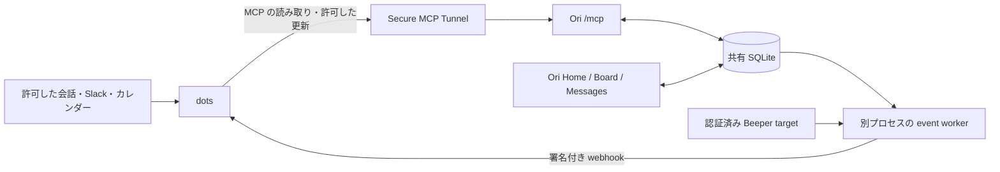

# dots ワークフローのセットアップ

Ori（Personal Workspace）をタスクと返信案の置き場にし、dots から新しい用件の整理、進捗の反映、日々の予定確認を行うためのガイドです。

まず手動で接続を確認し、必要なワークフローを一つずつ有効にします。すべての連携を最初から用意する必要はありません。

## 読む順番

1. [README のセットアップ](../README.md#セットアップ): 導入からイベント動作確認までの全体順序。AIに渡せる依頼文もあります。
2. [Linux / Nix の完全導入経路](dots/native-event-setup.md): 新規環境でOri、Beeper、web / workerの常駐化を準備。
3. [接続と運用の詳細](dots/setup.md#3-secure-mcp-tunnel-を用意しchatgpt-に登録する): Secure MCP Tunnel、ChatGPTの登録・Install・Refresh、購読。
4. [ワークフローテンプレート](dots/workflow-templates.md): 対象・時刻・通知先と許可範囲を決めて登録。
5. [動作確認](dots/setup.md#6-接続から動作までを分けて確認する): イベント配送、dotsの実行、期待した結果を確認。

画面と手動MCPだけを試す場合は、[Dockerの基本導入](dots/setup.md#2-基本の-ori-を起動する)も使えます。これは標準Composeだけでイベント自動化まで配備する手順ではありません。

## 構成

予定や Slack の読み取りには、それぞれの接続が別途必要です。図の各矢印は自動では作られません。Ori 内の Codex 実行は別の任意機能です。

## どこまで用意するか

| 目的 | 必要なもの |
| --- | --- |
| Ori にタスクを置く | Docker の core 構成、owner ログイン |
| dots からタスクを読む・許可した更新をする | 上記 + private な `/mcp`、Secure MCP Tunnel、ChatGPT の MCP プラグイン |
| Activity の変化を契機に dots を動かす | 上記 + event worker、共有 DB・鍵、購読、外向き HTTPS。現行 worker は Beeper target も必要 |
| Beeper の受信・送信を契機に処理する | 上記 + Beeper CLI と認証済み target、具体的なチャット選択 |
| Slack やカレンダーを読む | 対応する接続と利用権限。Ori 自体のカレンダー同期は未実装 |
| Ori 内で AI に委任する | 任意の `compose.ai.yaml` と Codex ログイン |

### 先に確認する注意点

- `/mcp` はブラウザの owner ログインを迂回します。公開インターネットには匿名公開せず、信頼できる private な接続に限定してください。
- 標準 Docker 構成には event worker の常駐起動や Beeper CLI は含まれません。現行 worker は Activity イベントだけでも Beeper target が必要です。
- イベントの購読成功、webhook の受領、dots の処理完了、Activity 更新は別々に確認します。
- タスクの作成・下書き保存は、外部への送信、予定の確定、カレンダー変更の許可を含みません。
- 実際のチャット ID、住所、個人用 URL、会話本文、鍵、認証情報は公開ドキュメントへ書き込まないでください。

## 再利用するときの設定

次の値を自分の環境で決め、テンプレートのプレースホルダーを置き換えます。未確定の値は推測で登録しません。

| 項目 | 決めること |
| --- | --- |
| タイムゾーン | IANA 名。例: `Asia/Tokyo`。予定表示・定時実行・日付境界を統一 |
| Ori の接続 | 実際の origin、private MCP URL、利用するプラグイン |
| 読み取り対象 | Beeper のチャット、Slack の workspace・channel、カレンダー |
| 通知先 | 本人との確認済み会話。不要な cross-post をしない |
| 実行頻度 | イベント起動か定時か。時刻未確認のテンプレートは設定後に確認 |
| 更新範囲 | 提案のみ、Activity 更新まで、外部送信までを個別に決定 |
| 終了・停止条件 | 単発の完了条件、継続監視の対象変更と停止方法 |

通知時刻だけでなく、停止・重複防止・取得失敗時の扱いもセットで決めます。既存の同じ設定がある場合は新規に複製せず、内容を確認して調整します。

## 設定の完了チェック

- [ ] Ori の owner ログインとタスクの永続化を確認した
- [ ] private な経路で `get_activity_context` が実データを返した
- [ ] 使用するソースと通知先を具体的に選んだ
- [ ] タイムゾーン、実行時刻／イベント、権限、停止条件を確認した
- [ ] 自動更新前に既存 Activity を読み、本人の編集・保留・完了判断を尊重する指示にした
- [ ] イベントを使う場合、worker と購読の両方を確認した
- [ ] 購読後のテストイベントで、dots の実行と期待した反映を確認した
- [ ] 送信結果が不明な場合は自動再送しないことを確認した
- [ ] 設定した内容と未確認事項を本人が読める形で残した

## このガイドの確認範囲

Ori の実装は [コミット `bf9587b7c25518209da8d26057bc0905cc304c58`](https://github.com/yutakobayashidev/ori/commit/bf9587b7c25518209da8d26057bc0905cc304c58) を 2026-10-13 に静的確認しています。セットアップ手順の実行、新しいトンネルの作成、ログイン、実イベント配送はこのドキュメント作成時には検証していません。

ワークフローは提供された仕様と設定情報を再利用しやすい形に整理したテンプレートです。現在有効な自動化を完全にエクスポートしたものではありません。定時実行の未確認箇所はテンプレート内に明記しています。実際に登録する際は、プラグインと利用環境の現在の仕様を確認してください。

## 関連資料

- [Docker deployment](docker.md)
- [HTTP MCP](http-mcp.md)
- [Workspace MCP Events](beeper-mcp-events.md)
- [Activity MCP](activity-mcp-design.md)
- [Activity numbers and audit history](activity-audit-and-numbers.md)
- [Storage and OAuth](storage-and-oauth.md)
