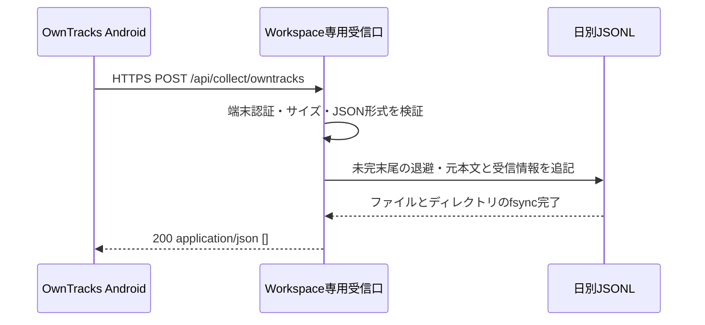

# OwnTracksコレクター：まず原記録を貯める

2026-10-12。日別JSONLへ保存するHTTPコレクターを実装。位置の正規化・地図・滞在推定は行わない。Androidからの実測送信確認は別途必要。

関連: [全体アーキテクチャ](architecture.md)、[生活観測設計](personal-observability-design.md)、[生活データソース比較](personal-data-source-comparison.md)。

## 実装した範囲

**OwnTracksのHTTP POSTを端末専用の資格情報で認証し、元JSON本文を受信情報とともに日別JSONLへ追記する。ファイルとディレクトリの同期完了後に`200 []`を返す。**

SQLiteへの取り込み、重複排除、型付き位置、逆ジオコーディング、AI解釈は後から追加する。現在のタスクやMCP通信ログを保存先にせず、外部AIの返信・実行支援にも変更を加えない。



## 設定

保存ディレクトリとcredentialファイルはGitの外に作り、Workspaceの実行ユーザーだけが読めるようにする。Linuxの単一サーバープロセスで使用し、同じ保存先へ複数のプロセスやreplicaから書かない。

```sh
install -d -m 700 /absolute/private/path/owntracks
```

credentialファイルの形式:

```json
{
  "username": "owntracks-phone",
  "password": "REPLACE_WITH_A_RANDOM_SECRET_OF_AT_LEAST_32_CHARACTERS",
  "deviceId": "android-main"
}
```

passwordは例文を使わず、`openssl rand -hex 32`等で生成した値に置き換える。ファイル権限は0600にする。汎用アプリ単体ではcredentialファイルの作成・配布や実機設定は行わない。初版は1端末分の設定で、設定ファイルはリクエストごとに再読込する。

```sh
WORKSPACE_OWNTRACKS_ARCHIVE_DIR=/absolute/private/path/owntracks
WORKSPACE_OWNTRACKS_CREDENTIAL_FILE=/absolute/private/path/owntracks-credentials.json
```

両方が設定されていない場合、受信口は404。相対パス、不正なcredentialファイル、読めないファイルは503。保存ディレクトリは事前作成が必要で、見つからない・書き込めない場合は保存失敗として503になる。

OwnTracks側ではHTTPモードを選び、HTTPS URLを`https://<workspace-host>/api/collect/owntracks`へ設定する。Identificationのusername/passwordへ上記の値を入力する。URLのqueryへsecretを入れず、Workspaceのログインpasswordを流用しない。payloadの`tid`や`X-Limit-D`は保存先端末IDの決定に使わず、認証設定の`deviceId`を使う。

現在のdotnix構成ではWorkspaceのHTTPS経路がtailnet制限下にある。AndroidのTailscale接続とACLを含む到達確認が必要。MCP専用トンネルは流用しない。

## UM790-ProとAndroidの設定

dotnixの`homes/nixos/UM790-Pro/twitter-lite.nix`で保存先と資格情報を設定する。サービス起動時に`~/.local/state/twitter-lite/owntracks/`と`owntracks-credentials.json`を作成し、passwordをランダム生成する。既存の資格情報は再配備でも保持する。

1. AndroidでTailscaleを接続する。
2. OwnTracksの接続モードをHTTPにする。
3. URLに`https://home.yutakobayashi.com/api/collect/owntracks`を設定する。
4. usernameは`owntracks-phone`、passwordはUM790-Proで次のコマンドから確認する。Device IDは`android-main`にする。
5. Androidの位置情報権限を常時許可し、バックグラウンド動作を許可する。まず手動publishで送信を試す。

```sh
jq -r .password ~/.local/state/twitter-lite/owntracks-credentials.json
```

credentialファイルやpasswordをGit・スクリーンショット・公開チャットに貼らない。Tailscale未接続時はこの受信先へ到達できない。送信確認はサーバーの`owntracks/*.jsonl`の件数・type・受信時刻で行い、位置の本文を公開ログに出さない。

## 保存形式

受信時刻のUTC日付で`2026-10-12.jsonl`へ追記する。遅延到着でも受信日へ保存し、測位時刻`payload.tst`は本文内にそのまま残す。新規ログと復旧断片のファイル権限は0600。

```json
{
  "version": 1,
  "id": "receiver-generated-uuid",
  "source": "owntracks",
  "device_id": "android-main",
  "received_at": "2026-10-12T01:23:45.000Z",
  "record_type": "location",
  "raw_body": "{\"_type\":\"location\",\"lat\":35,\"lon\":139,\"tst\":1791768225}"
}
```

`raw_body`は有効なUTF-8・JSONであることを検証した受信本文の文字列。空白・改行・未知フィールドを含め、再シリアライズで内容を変えない。外側をJSONにエスケープするので、本文が複数行でも1受信が1行になる。Authorization等のHTTPヘッダーは保存しない。記録自体には詳細な位置等が含まれるため、保存先は非公開で運用する。

再送も別の受信IDで追記する。各行は受信記録であり、実際の移動や活動の回数ではない。後日の読み取りモデルで重複を扱う。未知の`_type`も保存するが、`cmd`や`configuration`を実行しない。`encrypted`も本文保存のみで復号しない。設定dumpを能動要求する処理はない。

最後の改行より後にbytesが残っていたら、新しい追記の前に`<日付>.jsonl.<UUID>.incomplete`へ同期保存してから、元ファイルの末尾を切り詰める。UTF-8が途中で切れた断片もそのまま残す。復旧はその日付ファイルへ追記する際に行われるため、過去日の未完末尾は読み取り側で検出・無視し、削除しない。

正常に書き込まれた行とファイル名を確認する例:

```sh
ls -l /absolute/private/path/owntracks
jq -r '[.received_at, .device_id, .record_type] | @tsv' /absolute/private/path/owntracks/2026-10-12.jsonl
```

保存したJSONLと`.incomplete`はWorkspaceのSQLiteとは別にバックアップする。自動削除・圧縮は未実装。ディスク空き容量を確認し、運用中のファイルを外部からtruncateしない。

## HTTP契約

| 条件                                         | 応答・保存                                                      |
| -------------------------------------------- | --------------------------------------------------------------- |
| 認証済み、有効なJSON objectと空でない`_type` | 保存・同期後200 `[]`。Cookie・Originは不要                      |
| 認証済みの空本文                             | 200 `[]`、保存しない。OwnTracksの空publish互換                  |
| 不正・欠落したBasic認証                      | 401とBasic challenge、保存しない                                |
| POST以外                                     | 有効設定時405、Allow: POST                                      |
| 本文が1 MiBを超える                          | streamの実バイト数で413、保存しない                             |
| 非空本文でContent-Typeがapplication/json以外 | 415、保存しない                                                 |
| 不正UTF-8・JSON・配列・objectに_typeがない   | 400、保存しない                                                 |
| _typeが空白のみ、文字列以外、128文字超       | 400、保存しない                                                 |
| 保存・fsync失敗                              | 503、成功応答しない。途中まで書けていて再送が重複する場合もある |

1 MiBは初版の上限。画像付きメッセージ等で超える場合は、保持目的と負荷を見て別途変更する。座標・時刻等の意味的検証は行わず、受信後の正規化へ任せる。友人位置やremote commandは応答しない。エラーに元本文やsecretを含めない。

単一プロセス内で同期書き込みを行い、追記と末尾復旧を直列化している。ローカルLinux filesystemとfsyncを前提とし、任意のネットワークfilesystemや故障したストレージまで耐久性を保証するものではない。高頻度・巨大payloadの運用は未計測で、初版は個人の位置トラッカーを対象とする。

## 実装と検証

- [HTTP handler](../src/features/telemetry/owntracks/http.server.ts)：端末認証、本文上限、形式チェック、応答。
- [JSONL archive](../src/features/telemetry/owntracks/archive.server.ts)：追記、fsync、末尾復旧。
- [middleware](../src/start.ts)：この正確なpathだけをブラウザー向けgateより前で処理。他APIの認証・Origin制約を維持。
- [tests](../src/features/telemetry/owntracks/http.server.test.ts)：認証、未知フィールド、再送・並列受信、保存失敗、fsync失敗、未完末尾、日付分割。

配備後は手動publishでスマホ上の送信成功と保存行を照合し、サービス再起動と通信断からの再送も確認する。受信成功と、位置の正確さや欠測のなさは別に評価する。

## 参考プロジェクトから採用した点・変えた点

Aurboda確認commit: `7d67c7d038eccc5dc2a8dd3b4d686db0d74e15cd`。

| Aurbodaの実装                                       | 今回の実装                                             |
| --------------------------------------------------- | ------------------------------------------------------ |
| 小さなOwnTracks HTTP adapter、Basic認証、保存後`[]` | 受信と保存を分離し、専用credentialで同じprotocolに対応 |
| locationを型付きPostGIS表へ直接保存                 | 日別JSONLに原本文を保存し、正規化は後回し              |
| status・transition等は保存しない                    | JSON objectとして受け取り、typeを問わず原本文を残す    |
| UNIQUE(source,time)で競合を無視                     | 同秒・別type・内容変更・再送を破壊的にまとめない       |
| PostgreSQLユーザー資格情報を使用                    | 独立した端末専用credentialを使用                       |

[router][aurboda-router]、[schema][aurboda-schema]、[保存関数][aurboda-db]を静的確認。OwnTracks経路ではAurbodaの`raw_records`を使わない。waypointはrouterの`externalId`とDB関数の`external_id`に不整合もあるため、参考コードのコピーではなくprotocolと目的に合わせて実装した。Aurbodaのコードは取り込んでいない。

Timelinizeもimport時にItem等へ変換し、Personal Data VaultもAWの必要項目を表へ直接保存する。この2つには確認版でOwnTracks専用受信口はなく、今回の直接のprotocol参考はAurbodaとOwnTracks自身。[Timelinize調査](timelinize-research.md)、[Personal Data Vault調査](personal-data-vault-research.md)。

OwnTracksの[HTTP仕様][http]では2xxを送信成功として扱う。Android確認commit `3129fc23296c16ec5dd9f46d91d0fd94942b9f49`の[送信コード][android-http]もこの動作で、Basicと端末識別ヘッダーを設定する。Androidの[キュー][android-queue]には容量制限があるため、長期未接続も含む完全配送を保証しない。利用中のアプリ版との互換性は実機確認が必要。

[aurboda-router]: https://github.com/fiddur/aurboda/blob/7d67c7d038eccc5dc2a8dd3b4d686db0d74e15cd/apps/backend/src/integrations/owntracks/router.ts
[aurboda-schema]: https://github.com/fiddur/aurboda/blob/7d67c7d038eccc5dc2a8dd3b4d686db0d74e15cd/apps/backend/src/schema/locations.ts
[aurboda-db]: https://github.com/fiddur/aurboda/blob/7d67c7d038eccc5dc2a8dd3b4d686db0d74e15cd/apps/backend/src/db/locations.ts
[http]: https://owntracks.org/booklet/tech/http/
[android-http]: https://github.com/owntracks/android/blob/3129fc23296c16ec5dd9f46d91d0fd94942b9f49/project/app/src/main/java/org/owntracks/android/net/http/HttpMessageProcessorEndpoint.kt
[android-queue]: https://github.com/owntracks/android/blob/3129fc23296c16ec5dd9f46d91d0fd94942b9f49/project/app/src/main/java/org/owntracks/android/services/MessageProcessor.kt
