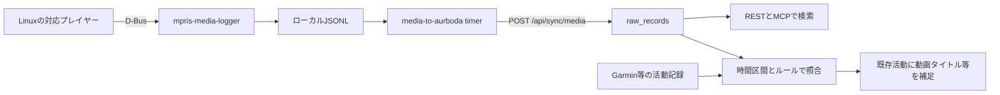

# 生活データソースの利用者評価と連携比較

調査日: 2026-10-11。対象はGravl、OwnTracks、MPRIS、Livsmedelsverket食品成分DBと、同じ用途の主要サービス・代替手段。
Personal Workspaceへの取り込み判断のため、知名度・利用者層・実際のレビューと、APIから得られるデータを分けて整理する。

結論として、Gravlは筋トレの計画・記録、OwnTracksは位置情報の収集、MPRISはPCの再生状態を読む規格、Livsmedelsverketは食品成分の参照データである。
4つを同種のアプリとして比較せず、本人が記録する情報、自動観測、参照DBを組み合わせる。PCの文脈を補う最初の実験にはMPRISが合い、食品DBは日本の食生活への適合を別途評価したい。

関連: [Aurboda調査と統合方針](aurboda-data-sources-research.md)。Aurbodaのコードはコミット `257fa0a5d68fc5012fdec5dce76744b5a2149bcd` を確認。製品の現行APIと、この固定時点の実装は区別する。

## 調査範囲と読み方

- Xはtwitter-api-relayスキルで検索。Gravl、OwnTracks、MPRISの英語・日本語検索と、Livsmedelsverketのdatabase/databas/API検索を実施した。
- Reddit MCPで投稿を検索し、代表的なスレッドのコメントを取得した。一部はdepth/more制限で省略されており、全コメント・全利用者の調査ではない。
- 累計ダウンロード、ストア評価数、現在の利用人数、ブランド認知率は別の指標。以下の数値は取得時点の表示であり、日本語ストアページの数字が日本だけの集計とは限らない。
- レビューは体験談、作者の投稿は自己申告として扱う。APIや技術仕様は公式資料・コードを優先する。「公開API未確認」は「APIが絶対に存在しない」という意味ではない。
- X検索には無関係な投稿が混ざった。Gravlの自転車関連、食品庁の政策議論などは除外した。売上・会員数に関する宣伝投稿を普及の確定値には使わない。

## 全体比較

| 対象             | 種類と主な利用者                                             | 知名度を判断できる材料                                           | Personal Workspaceへ入るもの                        |
| ---------------- | ------------------------------------------------------------ | ---------------------------------------------------------------- | --------------------------------------------------- |
| Gravl            | 筋トレのメニュー決定を任せたい人、Fitbod等との比較利用者     | Google Play 100万DL以上、約1.65万レビュー。日本App Storeは12評価 | 実施種目、セット、重量、回数、努力度、日時          |
| OwnTracks        | セルフホスト、Home Assistant、Google Timeline代替を求める人  | Google Play 10万DL以上、約500レビュー。日本語の利用例もある      | 位置・測位精度・時刻・滞在や出入りの材料            |
| MPRIS            | Linuxのデスクトップ利用者、プレイヤー・ウィジェット開発者    | playerctl、Waybar等で採用。規格としての利用人数は不明            | タイトル・URL・再生状態・位置などの構造化情報       |
| Livsmedelsverket | 栄養アプリ開発者、研究・栄養計算、スウェーデン食品を調べる人 | Lifesumが食品データ供給元として明記                              | 食品IDと100 gあたりの栄養値。本人の食事履歴ではない |

数値と採用の出典: [Gravl Google Play](https://play.google.com/store/apps/details?hl=ja&id=com.liteup.getgains)、[Gravl日本App Store](https://apps.apple.com/jp/app/gravl-ai-personal-trainer/id6450921637)、[OwnTracks Google Play](https://play.google.com/store/apps/details?id=org.owntracks.android)、[playerctl](https://github.com/altdesktop/playerctl)、[Waybar MPRIS](https://github.com/Alexays/Waybar/wiki/Module:-MPRIS)、[Lifesum](https://lifesum.com/sv/features/)。

## Gravl

### 利用者層とレビュー

ジムの設備・目的・履歴に応じて提案されたメニューを実施し、重量・回数・セット・難易度を記録するアプリ。
受動的に身体を測るセンサーではなく、本人の入力が重要なデータ源である。レビューでは、メニューを考える負担を減らしたい一般利用者と、細かな処方を調整したい経験者で評価が分かれる。

Google Playは取得時4.8/5、米国App Storeは約5,800評価・4.9/5、日本App Storeは12評価・4.8/5。累計DLと評価件数から一定の商用規模は確認できるが、MAU・国内シェア・継続率は分からない。
日本App Storeの言語一覧では日本語を確認できず、日本語ストア説明の存在と日本語UI対応を混同しない。[米国App Store](https://apps.apple.com/us/app/gravl-ai-personal-trainer/id6450921637)、[日本App Store](https://apps.apple.com/jp/app/gravl-ai-personal-trainer/id6450921637)。

| 日付・媒体               | 実際の声                                                                                       | 読み取り                                                                          |
| ------------------------ | ---------------------------------------------------------------------------------------------- | --------------------------------------------------------------------------------- |
| 2026-07-26 Reddit        | 経験者がセット・努力度の記録や動画を評価する一方、筋群バランス・設定との不整合・修正負担を批判 | 厳密なトレーニング方針を持つ人には、自動処方が合わない場合がある                  |
| 同スレッドの別利用者     | 早朝に計画を考えなくてよい、修正可能な土台が便利、初心者でも実施しやすい                       | 判断負荷の軽減が主な価値。効果・継続率の比較試験ではない                          |
| 2026-10-08 Reddit        | Claudeの定期処理とGravl MCPで履歴比較を運用。Apple Health由来の体重がAPIで一部欠けるとの報告   | アプリの画面とAPIの完全一致は実データで確認が必要。開発者が調査回答、解決は未確認 |
| 2025-06-22 日本App Store | 設定は簡単だが、日本語対応を希望                                                               | 日本での入力・継続の障壁は言語にもある                                            |

出典: [経験者の批評と議論](https://www.reddit.com/r/Gravl/comments/1v6qzgl/good_but_still_disappointing_ai_slop/)、[判断負荷への評価](https://www.reddit.com/r/Gravl/comments/1v6qzgl/good_but_still_disappointing_ai_slop/ozusj7z/)、[API Gap](https://www.reddit.com/r/Gravl/comments/1x0lvsa/api_gap/)、[日本語レビュー](https://apps.apple.com/jp/app/gravl-ai-personal-trainer/id6450921637?platform=iphone&see-all=reviews)。

開発者は上記Redditで、ワークアウト生成の中核はルールベースと説明している。「AI」という製品名から全処理がLLMであると推測しない。[開発者回答](https://www.reddit.com/r/Gravl/comments/1v6qzgl/good_but_still_disappointing_ai_slop/oztd0yx/)。

Xでは独立した詳細レビューより、起業・開発・売上紹介が上位に多かった。[2026-03-23の開発者紹介](https://x.com/betomoedano/status/2035892806019932647)は認知されるコミュニティの例だが、売上の独立検証ではない。
`Gravl lang:ja`には自転車等が混ざり、`"Gravl" "app" lang:ja`では結果なし。今回の検索で日本語レビューが少なかったこと以上は言えない。

### APIとAurbodaの利用範囲

公式RESTはread-onlyで、個人トークンまたはOAuthを利用。ワークアウト、テンプレート、split、自己ベスト、身体計測等を提供する。
一方、公式MCPはワークアウトの記録・削除、メニューや設定の変更も可能。RESTとMCPで操作範囲が異なる。[REST](https://gravl.ai/developers)、[項目一覧](https://gravl.ai/developers/endpoints)、[MCP](https://gravl.ai/developers/mcp)。

セットの重量はAPI上lb、距離はm。表示設定を見てkgと決めつけない。身体計測はレコードの単位に従う。制限はappとuserの組み合わせで100リクエスト/15分と説明される。[単位と制限](https://gravl.ai/developers/conventions)。

Aurbodaはワークアウト一覧と詳細を取得し、元JSONに加え、`strength_training`活動へ種目・重量kg・回数・秒・距離・RPE・セット種別等を保存する。
Health Connect由来の同じGravlセッションとIDを合わせ、APIの詳細で補う。初回90日、その後は前回成功の2日前から再取得する。Gravlの全APIを同期する実装ではない。
[変換処理](https://github.com/fiddur/aurboda/blob/257fa0a5d68fc5012fdec5dce76744b5a2149bcd/apps/backend/src/integrations/gravl/process.ts)、[同期処理](https://github.com/fiddur/aurboda/blob/257fa0a5d68fc5012fdec5dce76744b5a2149bcd/apps/backend/src/integrations/gravl/sync.ts)。

### 競合と大手の連携経路

| 候補                     | 主な用途・利用層                                     | 公開APIとデータ出力                                                                                         | 統合上の判断                                                                                              |
| ------------------------ | ---------------------------------------------------- | ----------------------------------------------------------------------------------------------------------- | --------------------------------------------------------------------------------------------------------- |
| Gravl                    | 提案された筋トレメニューを実行したい人               | 個人トークン/OAuthのREST読み取り、操作可能な公式MCP                                                         | セット詳細を取得しやすい。トークン発行に必要な契約条件は今回未確認                                        |
| Fitbod                   | 設備・目標・回復等に応じたメニュー提案。直接競合     | 一般開発者向け公開APIの公式仕様は今回未確認。Apple Health/Health Connect等の公式連携                        | CSVは利用者報告あり、iOS/Androidで手順差の報告。具体的な出力項目・OS対応は確認が必要                      |
| Hevy                     | 自分のルーティンを記録・分析・共有したい人           | Pro向け公開API、API key。workouts、routines、種目、身体計測、workoutの変更・削除イベント。CSV出力も公式案内 | 自前の推論と実績同期を組み合わせる有力候補。ただしAPIは実験的で変更・廃止の可能性を明記                   |
| Strong                   | シンプルな筋トレノート、自分のプログラムを記録する人 | 一般向け公開API仕様は今回未確認。iOS/AndroidのCSV出力を公式案内                                             | 自動API連携よりCSV取り込み向き。Strongへ同じCSVを再インポートできるわけではない                           |
| Garmin Connect           | 時計から運動・心拍・睡眠等を集める人                 | 公式Developer Programは事業者向け審査制、OAuth2                                                             | 個人が即座に使えるAPIとは違う。Aurbodaのセッションベース取得と公式事業者APIを混同しない                   |
| Apple Health / HealthKit | Watchや複数の健康アプリをまとめる端末側基盤          | データ種別ごとの許可を伴うネイティブSDK。クラウドRESTではない                                               | Linux/Web側へは端末アプリ等の橋渡しが必要。各アプリが書き込んだ範囲のみで、全セット詳細が移るとは限らない |

出典: [Fitbod公式連携](https://help.fitbod.me/hc/en-us/sections/35305345636375-Integrations)、[Fitbod CSVの利用者報告](https://www.reddit.com/r/fitbod/comments/1vmtl4n/exporting_workout_data/)、[Hevy API](https://api.hevyapp.com/docs/)、[Hevy出力](https://help.hevyapp.com/hc/en-us/articles/43708290987415-Exporting-Your-Data-from-Hevy)、[Strong出力](https://help.strongapp.io/article/235-export-workout-data)、[Garmin公式FAQ](https://developer.garmin.com/gc-developer-program/program-faq/)、[HealthKitの権限](https://developer.apple.com/documentation/healthkit/authorizing-access-to-health-data)。

規模の参考として、Hevyは公式に1,700万以上のusers、Fitbodは公式FAQに1,500万downloads・25万以上MAUを掲載している。各社の自己申告かつ異なる指標・集計時点であり、GravlのストアDLと順位付けしない。
Strongは公式ページ内で利用者数の表示が揃わないため、確定した現行人数として引用しない。
[Hevy About](https://www.hevyapp.com/about-us/)、[Fitbod FAQ](https://fitbod.me/faqs/)、[Strong](https://www.strong.app/)。

Gravlの強みは次に何をするかを決める負担の軽減、Hevyの強みは本人が決めたプログラムの記録とAPI同期という役割分担が考えられる。
Personal Workspace側で提案を作るならHevyも比較対象にし、日常の入力を続けられるかで選ぶ。

## OwnTracks

### 利用者層とレビュー

位置情報を自分で選んだサーバーへ送るiOS/Androidアプリ。保存サーバーのOwnTracks Recorderは別コンポーネントで、アプリ・保存・可視化を別々に選べる。
Google Playは取得時10万DL以上、3.9/5、約500レビュー。Google Timeline代替、帰宅・外出の自動化、家族との位置共有、長期の位置履歴保管を求めるセルフホスト層で話題になっている。[Google Play](https://play.google.com/store/apps/details?id=org.owntracks.android)、[Recorder](https://github.com/owntracks/recorder)。

| 日付・媒体                   | 実際の声                                                                              | 読み取り                                                     |
| ---------------------------- | ------------------------------------------------------------------------------------- | ------------------------------------------------------------ |
| 2025-04-07 Reddit            | 長年使ったが、間隔が長いと位置が飛び、Moveモードでは日次バッテリー15〜20%と報告       | 個別端末・設定の体験。一般的な電池消費率ではない             |
| 同スレッドの別利用者         | Significantモード等の設定で1%以下、精度も許容と報告                                   | 同じ製品でも評価が逆。OS・モード・頻度を揃えて試す必要がある |
| 同スレッド                   | HA Companionの位置をMQTT転送してRecorderへ保存、またはOwnTracksをDawarichの入力に利用 | 全構成をOwnTracksで揃える必要はない                          |
| 2025-02-02 日本語Google Play | セルフホスト可能なGoogle Timeline代替として評価                                       | 日本の実利用例。国内普及率は不明                             |
| 2025-01-16 日本語X           | 記録は良いがMoveは細かすぎるためSignificant Changesを試すという報告                   | 国内でも設定を調整して使う層がいる                           |

出典: [バッテリー消費への不満](https://www.reddit.com/r/selfhosted/comments/1jtg47d/replacing_google_timeline_with_owntracks/mlug4cd/)、[低消費という報告](https://www.reddit.com/r/selfhosted/comments/1jtg47d/replacing_google_timeline_with_owntracks/mlvpobt/)、[全体の議論](https://www.reddit.com/r/selfhosted/comments/1jtg47d/replacing_google_timeline_with_owntracks/)、[日本語Google Play](https://play.google.com/store/apps/details?hl=ja&id=org.owntracks.android)、[日本語Xのモード比較](https://x.com/_jeykey_/status/1879877188763439324)。

Xには[M5Stackでの地図表示例](https://x.com/mokjpn/status/1656608833840754688)もあり、自作デバイス・自宅システムに組み込む利用像が見える。一般向けアプリの知名度より、こうした連携可能性が強みである。

### APIとAurbodaの利用範囲

公開JSONをHTTP POSTまたはMQTTで送る。位置には緯度経度・測位時刻・精度・高度・速度・バッテリー・通信種別・region等があり、端末・OSで任意項目が異なる。
`transition`はregionの出入り、`waypoint`は名前・位置・半径などの定義。Recorderはファイルへ保存し、REST・WebSocket・GeoJSON等を提供する。[JSON仕様](https://owntracks.org/booklet/tech/json/)、[HTTP](https://owntracks.org/booklet/tech/http/)、[Recorder](https://github.com/owntracks/recorder)。

精度と電池消費はモード・OS・バックグラウンド制限に依存する。Home Assistantも低精度の測位を除外する設定を説明している。
「ジムに滞在」と「筋トレを実施」は別の情報として扱う。[モード](https://owntracks.org/booklet/features/location/)、[HA統合](https://www.home-assistant.io/integrations/owntracks/)。

AurbodaはHTTP受信で`location`の`lat/lon/tst/inregions/acc/alt/vel`を保存し、`waypoint`を場所として登録、位置から滞在を検出する。
この入口ではbattery・端末topic等の全項目や`transition`を保存しない。`locations`の一意性はsourceとtimeであり、同一ユーザーの複数端末を区別する設計には注意が必要。
[受信router](https://github.com/fiddur/aurboda/blob/257fa0a5d68fc5012fdec5dce76744b5a2149bcd/apps/backend/src/integrations/owntracks/router.ts)、[位置DB](https://github.com/fiddur/aurboda/blob/257fa0a5d68fc5012fdec5dce76744b5a2149bcd/apps/backend/src/db/locations.ts)。

### 競合と大手の連携経路

| 候補                     | 主な用途・利用層                                          | API・出力                                                                                     | Personal Workspaceへの位置付け                                                                      |
| ------------------------ | --------------------------------------------------------- | --------------------------------------------------------------------------------------------- | --------------------------------------------------------------------------------------------------- |
| OwnTracks                | 自分で位置履歴を保持したい人、自宅自動化                  | 任意HTTP endpoint/MQTTへ公開JSON。RecorderならREST/GeoJSON等                                  | collectorを自作せず独自の受信先へ送れる                                                             |
| Google Maps Timeline     | 訪問先・移動を振り返る一般Maps利用者                      | 端末から出力。iOS公式手順は`location-history.json`。個人履歴を継続取得する公開APIは今回未確認 | 過去履歴のインポート候補。Routes APIは経路計算であり本人の履歴APIではない                           |
| Life360                  | 家族の位置共有・到着通知・運転履歴                        | 一般開発者向け個人履歴APIは今回未確認。公式はアプリから運転履歴等をexport/印刷できないと説明  | 家族共有のUX参考。非公式APIへ依存する長期同期は優先度を下げる                                       |
| Home Assistant Companion | HA利用者、家とスマホの状態連携                            | 自前HAへ位置等を送信し、HAのREST states/historyやWebSocketイベントで取得                      | 既にHAを使うなら重複collectorを増やさず済む。Companionを任意のPW endpointへ直接向ける仕組みではない |
| Dawarich                 | Google Timeline代替、地図・訪問地の履歴を自分で持ちたい人 | セルフホスト可能。API keyと`/api-docs`、OwnTracks互換入力、GPX/GeoJSONやアカウント出力        | 地図や移行機能まで欲しいときの候補。PWの観測基盤と重複する範囲を決める                              |

出典: [Google Timelineと出力](https://support.google.com/maps/answer/6258979?co=GENIE.Platform%3DiOS&hl=en-GB)、[Google Routes](https://developers.google.com/maps/documentation/routes/compute-route-over)、[Life360履歴](https://support.life360.com/hc/en-us/articles/23053602225559-Location-Drive-History)、[HA Companion位置](https://companion.home-assistant.io/docs/core/location/)、[HA REST](https://developers.home-assistant.io/docs/api/rest/)、[HA WebSocket](https://developers.home-assistant.io/docs/api/websocket/)、[Dawarich API入力](https://dawarich.app/docs/getting-started/track-your-location/)、[Dawarich出力](https://dawarich.app/docs/features/points/)。

Life360の非公式HA連携では403/429やトークン取得に関する修正が続く。非公式に呼び出せることと、一般向け公式APIが提供されていることは別である。
HAの状態履歴も保持設定に依存するため、長期観測には必要な記録を継続取り込みする。[非公式連携の変更履歴](https://github.com/pnbruckner/ha-life360/releases)。

## MPRIS

### 知名度と利用者層

MPRISはLinux等のD-Bus上でメディアプレイヤーを発見し、状態・メタデータを読み、再生操作を行う公開規格。単独の記録アプリやクラウドサービスではない。
playerctlやWaybarに採用され、メディアキー、ステータスバー、ロック画面、独自ウィジェットを作る層に使われている。
プレイヤーによって組み込み対応または追加プラグインが必要で、MPRIS対応というだけで全項目が埋まるとは限らない。
[公式仕様](https://specifications.freedesktop.org/mpris/latest/)、[playerctl](https://github.com/altdesktop/playerctl)、[Waybar](https://github.com/Alexays/Waybar/wiki/Module:-MPRIS)。

| 日付・媒体                 | 実際の声                                                        | 意味                                                                           |
| -------------------------- | --------------------------------------------------------------- | ------------------------------------------------------------------------------ |
| 2025-04 Reddit r/archlinux | playerctlでFirefoxの再生を操作し、曲のメタデータも取れたと報告  | ブラウザ横断の軽量な入力源になる具体例                                         |
| 2026-08 Reddit r/Noctalia  | mpd-mpris等を動かしてもコントロールセンターとつながらないと相談 | プレイヤー・bridge・表示側の組み合わせで問題が起こる                           |
| 2026-09 Reddit r/kde       | Harunaを複数起動したときのMPRISインスタンスについて不満         | 複数プレイヤーの扱いも検証対象。規格全体の不具合とは限らない                   |
| 2023-08 日本語X            | Spotifyが最初のアーティストしか渡さず、曲情報表示に困ると報告   | 供給元のメタデータ欠損は収集側だけでは補えない。現在の全環境への一般化はしない |
| 2024〜2026 日本語X         | ステータスバー・ロック画面へのMPRIS組み込み例                   | 日本でもデスクトップのカスタマイズ用途が見られる                               |

出典: [Firefoxで成功](https://www.reddit.com/r/archlinux/comments/1k3xlxe/is_there_a_way_to_make_mpd_to_know_which_song_is/moi42b2/)、[Noctaliaの接続相談](https://www.reddit.com/r/Noctalia/comments/1vuoss4/troubles_with_connecting_mpd_to_noctalia_control/)、[Harunaの複数起動](https://www.reddit.com/r/kde/comments/1w7dscv/haruna_video_player_doesnt_make_multiple_mpris/)、[Spotifyのアーティスト情報](https://x.com/KowerKoint2010/status/1694680679005704394)、[ロック画面の実装例](https://x.com/McbeEringi/status/2064754160600547725)。

### 取得できるものと取得できないもの

| MPRISの情報                        | 利用例                             | 限界                                                                       |
| ---------------------------------- | ---------------------------------- | -------------------------------------------------------------------------- |
| `xesam:title/artist/album/url`     | 曲・動画の識別、資料へのリンク     | 空欄や不正確な値、ブラウザ側の省略があり得る                               |
| `mpris:length`、`Position`         | コンテンツ長と再生位置             | 未提供の場合がある。Positionはマイクロ秒、通常の位置進行は変更通知されない |
| `PlaybackStatus`、`Rate`、`Seeked` | 再生・一時停止・速度・シークを考慮 | アプリごとの実装品質に依存                                                 |
| プレイヤーのD-Bus名                | どのアプリ・インスタンスか         | 履歴は別途保存が必要                                                       |

音声や動画の内容、字幕全文、実際に視聴したか、内容を理解したかは、この規格だけでは分からない。
[Playerインターフェース](https://specifications.freedesktop.org/mpris/latest/Player_Interface.html)。

### AurbodaはMPRISをどう組み込んでいるか

**クライアントはIssueに掲載された実装例、サーバーはリポジトリ内の実装**として確認した。作者はArch/Omarchyでの動作確認を報告しており、今回NixOSで実機検証したわけではない。

Python/Gioのloggerがsession D-Busを直接監視し、5秒ごとのPosition差分から再生量を推定する。曲の切替・停止・プレイヤー終了等で区切り、JSONLへ保存する。
`playerctld`の代理表示は重複回避のため除外。別のsystemdユーザーtimerが5分ごとにバッチ送信し、送信失敗時は記録を残す設計である。
出典: [Issue #1155のクライアント実装](https://github.com/fiddur/aurboda/issues/1155)。

| 保存・公開する項目                | 意味                                     |
| --------------------------------- | ---------------------------------------- |
| `id`、`device`、`player`          | 再送時の同定、端末、プレイヤー           |
| `url/title/artist/album`          | プレイヤーから受け取ったメタデータ       |
| `started_at/ended_at`             | 観測区間の開始・終了                     |
| `played_secs`                     | Position差分から算出したコンテンツ秒数   |
| `track_secs`                      | 全長。不明ならnull                       |
| `max_position_secs`、`seek_count` | 最も先へ到達した位置、検出したシーク回数 |
| 読み取り時の`played_ratio`        | 再生秒数/全長。不明ならnull              |

サーバーは`source=mpris`、`record_type=media_play`として元記録を保存する。受信だけで新しい活動にはしない。
RESTの`/api/media/plays`、MCPの`query_media_plays`等とData画面から検索できる。
Last.fmにも同じ曲がある場合、タイトル・アーティストが一致し開始時刻が5分以内なら、読み取り時に情報の豊富なMPRISを優先する。
[連携仕様](https://github.com/fiddur/aurboda/blob/257fa0a5d68fc5012fdec5dce76744b5a2149bcd/docs/media.md)、[変換・重複排除](https://github.com/fiddur/aurboda/blob/257fa0a5d68fc5012fdec5dce76744b5a2149bcd/apps/backend/src/services/media-plays.ts)。

主な実例は、Garminが記録したヨガの時間と動画再生を照合し、既存活動の`session_name`へ動画タイトルを補うこと。
動画記録と運動記録のどちらが先に届いても、後から照合する。少し見ただけの動画も元記録として残し、意味付けは後段のルールで行う。
[ルールと実行順序](https://github.com/fiddur/aurboda/blob/257fa0a5d68fc5012fdec5dce76744b5a2149bcd/docs/media.md)。

移植時には次を確認したい。

- 掲載loggerは位置差分による近似。再生速度を明示的に使っていないため、倍速再生や小さなシークを含めて実測する。`played_secs`を本人が見た実時間と呼ばない。
- 一時停止を挟んだ開始〜終了の区間と、再生量は別。区間全体を視聴時間として扱わない。
- サーバー実装では`played_ratio=null`でも`min_played_ratio`条件を通過する。閾値を設定しただけで「8割視聴を確認できた」とは言えない。
- 再視聴の積算はユニークな視聴範囲ではない。再生割合だけで完視聴や運動実施を確定しない。

根拠: [クライアントの計算](https://github.com/fiddur/aurboda/issues/1155)、[条件評価の実装](https://github.com/fiddur/aurboda/blob/257fa0a5d68fc5012fdec5dce76744b5a2149bcd/apps/backend/src/services/media-plays.ts)。

### 大手サービスと代替手段のAPI

MPRISはOS上の観測、以下のクラウドAPIは特定サービス内の履歴であり、補完関係になる。

| 手段                       | API・取得範囲                                                                    | 条件と限界                                                                                                    |
| -------------------------- | -------------------------------------------------------------------------------- | ------------------------------------------------------------------------------------------------------------- |
| MPRIS / playerctl          | ローカルD-Busで現在の状態・メタデータ                                            | APIキー不要。対応プレイヤーと動作中のcollectorが必要。過去履歴は自前保存                                      |
| Spotify Web API            | OAuthで最近再生した曲、`played_at`、曲情報。recently-playedは1リクエスト最大50件 | 新規Development Modeは所有者Premium、認証ユーザー最大5人等の制約。曲の長さと実際に聴いた秒数は別              |
| Apple Music API / MusicKit | ユーザー許可で最近再生したコンテンツ等                                           | developer token・music user token等が必要。詳細な再生開始/終了の全履歴が得られるとは限らない                  |
| Last.fm                    | `user.getRecentTracks`でscrobble、アーティスト、曲、時刻等                       | APIキー必要、当該読み取りはユーザー認証不要。記録を送った範囲の音楽履歴で、動画や視聴秒数の万能な記録ではない |
| ListenBrainz               | RESTでlistenの送信・取得                                                         | 音楽履歴の蓄積先。ローカルプレイヤーの観測は別途必要                                                          |
| YouTube Data API           | 動画メタデータ等の公開API                                                        | 個人のWatch Historyは取得対象外。Data APIがあることと視聴履歴へのアクセスは別                                 |

出典: [Spotify recently-played](https://developer.spotify.com/documentation/web-api/reference/get-recently-played)、[Spotify quota](https://developer.spotify.com/documentation/web-api/concepts/quota-modes)、[Apple MusicKit](https://developer.apple.com/musickit/)、[Last.fm](https://www.last.fm/api/show/user.getRecentTracks)、[ListenBrainz API](https://listenbrainz.readthedocs.io/en/latest/users/api/index.html)、[YouTubeの履歴アクセス制限](https://developers.google.com/youtube/v3/revision_history#january-28,-2021)。

## Livsmedelsverket食品成分DB

### 知名度と利用者の声

スウェーデン食品庁の食品成分DB。食事記録アプリや市販品バーコードDBとは役割が異なる。
Lifesumが食品データの供給元の一つとして採用を明記している。Aurbodaや個人開発アプリでも利用されるが、DB自体の利用者数や認知率は確認できなかった。[Lifesum公式](https://lifesum.com/sv/features/)。

| 日付・媒体                  | 実際の声                                                                                                             | 限界                                                                  |
| --------------------------- | -------------------------------------------------------------------------------------------------------------------- | --------------------------------------------------------------------- |
| 2022-03 Reddit r/sweden     | 以前の食品庁の食事日記はスウェーデン食品に合い、ビタミン・ミネラルを見られてよかった。米国アプリでは食品を探しにくい | 現行APIへのレビューではない。地域の食品DBと入力負担の関係を示す体験談 |
| 2025-02 Reddit r/cronometer | 鶏レバーのビタミンA値がUSDA/NCCDBとスウェーデンDBで異なると相談                                                      | 原因は解決しておらず、どちらが正しいという証拠ではない                |
| 2026-09 Reddit              | Kalorikoll作者がLSV・USDA等を同梱したローカル食事記録アプリを紹介                                                    | 開発者の自己申告。独立した品質評価ではない                            |

出典: [地域に合う食事日記](https://www.reddit.com/r/sweden/comments/ta1ly9/matdagbok_anpassad_för_svenska_förhållanden/)、[栄養値の差への疑問](https://www.reddit.com/r/cronometer/comments/1ifa0ti/vitamin_a_data_base_differences/)、[Kalorikoll](https://www.reddit.com/r/droidappshowcase/comments/1w85zui/kalorikoll_localfirst_nutrition_tracker/)。

Xの食品庁名検索は政策・健康助言への議論が多く、食品DBそのものの利用レビューとして使える結果は今回ほぼ得られなかった。食品庁への賛否をDBの評判に置き換えない。

### データとAurbodaの取り込み

公式検索は取得時2,606食品、版2026-07-01。可食部100 gを基準に、エネルギー・主要栄養素・脂肪酸・ビタミン・ミネラル等を扱う。
公開APIは食品一覧・栄養値・分類等を提供する。公的DBでも、全項目が個々の食品の実測値とは限らず、借用・推定・調理計算を含む。
[公式検索](https://soknaringsinnehall.livsmedelsverket.se/)、[Swagger](https://dataportal.livsmedelsverket.se/livsmedel/swagger/index.html)、[作成方法](https://www.livsmedelsverket.se/livsmedel-och-innehall/naringsamne/livsmedelsdatabasen/omlivsmedelsdatabasen/)。

Aurbodaは管理者の一括インポートで食品一覧と各食品の栄養値を取得し、EuroFIRコードを内部の栄養カラムへ対応付ける。
`source=livsmedelsverket`と食品番号をキーに共有食品ライブラリへupsertし、食事登録時には食品名・栄養値をスナップショットする。
名称と栄養値を主に利用し、API内の分類・原材料・各値の詳細な由来まで全面的に保存する実装ではない。
[importer](https://github.com/fiddur/aurboda/blob/257fa0a5d68fc5012fdec5dce76744b5a2149bcd/apps/backend/src/services/imports/livsmedelsverket.ts)、[共有食品](https://github.com/fiddur/aurboda/blob/257fa0a5d68fc5012fdec5dce76744b5a2149bcd/apps/backend/src/services/central-food-items.ts)。

実装はg/mg/µgの変換や未知コードの除外を行う。一方、100 g基準を前提とし、原データ版や分析・推定の区別を全面的には保持しない。
文書に未対応と書かれたナイアシン当量・ショ糖・単糖類も、固定コミットのコードでは対応済み。移植対象は説明文だけでなくコードとテストで確認する。

### 競合する食品DBと大手API

| 候補                      | 主な対象                                               | API・出力とアクセス条件                                                                                     | 保存・利用上の注意                                                                                       |
| ------------------------- | ------------------------------------------------------ | ----------------------------------------------------------------------------------------------------------- | -------------------------------------------------------------------------------------------------------- |
| Livsmedelsverket          | スウェーデンの標準食品・調理食品                       | 公開REST。Aurbodaはキーなしで利用                                                                           | CC BYの出典表示を確認。個人の食事履歴は含まない                                                          |
| USDA FoodData Central     | 米国の基礎食品、調査用食品、ブランド食品等             | data.gov APIキーによるREST、CSV/JSON一括配布                                                                | CC0/public domain。基礎食品の分析値と商品ラベル値を区別する                                              |
| Open Food Facts           | 世界の包装食品、バーコード、原材料、栄養表示           | 読み取りAPIはキー不要、識別可能なUser-Agentを要求。バルク配布あり                                           | DBはODbL。利用・再配布の条件と画像等の条件を確認。地域や商品による欠損があり、精密な標準食品成分表とは別 |
| 文科省 日本食品標準成分表 | 日本で常用される食品、調理状態、詳細成分               | 公式Excelと検索サイト。一般公開REST仕様は今回未確認                                                         | 公式は自由利用と二次利用時の出典記載を案内。日本の一般食品の基礎候補。商品バーコード・本人の食事履歴は別 |
| fatsecret Platform        | 国別食品・商品・レシピ、ユーザーの食事・運動・体重履歴 | 登録・認証を伴う商用REST。食事履歴は3-legged OAuth。Basic無料枠はUSのみ、日本は地域アクセスの契約確認が必要 | 保存可能データに制限があり、自前DBへの全件長期複製を前提にしない                                         |

出典: [LSVの検索・出典説明](https://www.livsmedelsverket.se/livsmedel-och-innehall/naringsamne/livsmedelsdatabasen/sok-naringsinnehall/)、[USDA API](https://fdc.nal.usda.gov/api-guide/)、[USDA配布](https://fdc.nal.usda.gov/download-datasets/)、[Open Food Facts API](https://openfoodfacts.github.io/openfoodfacts-server/api/)、[OFF利用条件](https://support.openfoodfacts.org/help/en-gb/12-donnees-api/94-y-a-t-il-des-conditions-pour-utiliser-l-api)、[文科省配布](https://www.mext.go.jp/a_menu/syokuhinseibun/mext_00001.html)、[文科省の利用案内](https://www.mext.go.jp/a_menu/syokuhinseibun/index.htm)、[fatsecret API](https://platform.fatsecret.com/docs/guides)、[fatsecretプラン](https://platform.fatsecret.com/api-editions)。

fatsecretの公式Storable Dataは、明示された項目を除くuser dataについて24時間を超えるキャッシュを認めないと説明する。永続保存できる項目は食品・食事項目のIDやトークン等が中心。
食事履歴APIがあっても、Personal Workspaceへ栄養値や履歴を永久保存できるとは限らない。採用前に契約・保存範囲を確認する。[保存可能データ](https://platform.fatsecret.com/docs/guides/storable-data)。

日本の生活を対象にするなら、文科省の一般食品を基本候補とし、市販品はラベルやOpen Food Facts等で補完する案が自然。
スウェーデン食品が必要ならLSV、英語食品や他の参照値が必要ならUSDAを追加する。どのDBでも出典・版・食品の状態を保持し、同名食品を無条件に統合しない。
写真AIは食品と分量の候補を作り、栄養値は出典付き参照DBから計算する。推定量と成分表の値を、実測した摂取量として扱わない。

## Personal Workspaceでの判断

| 入力      | 優先する検証                                                                        | 独自に保持したい情報                                                             |
| --------- | ----------------------------------------------------------------------------------- | -------------------------------------------------------------------------------- |
| MPRIS     | 普段のブラウザ・プレイヤーでURL/Positionが取れるか。Pause・Seek・倍速で集計が妥当か | 端末・プレイヤー、元メタデータ、欠損、再生量の計算法。視聴や学習の意味は別の注釈 |
| OwnTracks | 現在のHA Companionで足りるか。帰宅・外出の遅延と電池負担                            | 端末ID、測位と受信の時刻、精度、欠測                                             |
| Gravl     | 自分が継続入力できるか。APIとアプリの実施記録が一致するか                           | 計画と実績の区別、セット詳細、単位、他ソースとの同定                             |
| 食品DB    | 日本の普段の食事に合うか。未入力・欠損をゼロ扱いしていないか                        | 出典・食品ID・版・調理状態・基準重量と、実際に食べた量を分離                     |

MPRISは「画面を常時解析しなくても、何を再生していたかという意味のある情報を取得できる」例になる。
ActivityWatch、URL、選択中タスク、MPRISで不足する場面を特定してからVLMを足す比較がよい。
Aurbodaのヨガ連携のように、観測は保存し、別ソースとの時間的な照合で注釈を補う構成を参考にする。

## 身体計測・服薬とルーティンの統合

2026-10-11の追加会話を要約。以下の製品情報は会話中に挙がった公式資料・コードへの参照を保存したもので、この追記時に機器の接続やAPI同期を実測したものではない。対応項目・利用条件は導入時に再確認する。

本人が確認した利用環境は **Android、Oura、約2,000円のXiaomi体重計、RENPHO体重計**。体重計の型番と利用中のアプリは未確認。血圧計を所有しているとは確認できていない。

| 対象   | 取り込み候補                                            | 取得対象・確認事項                                                                                           |
| ------ | ------------------------------------------------------- | ------------------------------------------------------------------------------------------------------------ |
| Oura   | CloudのOAuth API → PW                                   | 睡眠・活動・レディネス・心拍・本人のタグ。持っているデータから始める。取得可能期間や同期遅延は実データで確認 |
| RENPHO | RENPHO Health → Health Connect → Android収集アプリ → PW | 公式にHealth Connect連携の案内あり。手元の型番・アプリで体重や各項目が書き出されるかを確認                   |
| Xiaomi | 対応機種のBLE → ESPHome／Home Assistant → PW            | ESPHomeにXiaomi Miscaleがあるが、ブランドだけでは対応を判断できない。型番と測定の受信方法を確認              |
| 血圧   | 例：OMRON connect → Health Connect → PW                 | 日本向け公式FAQに出力案内あり。機種・取得項目・測定時刻を確認。購入済みという意味ではない                    |
| 服薬   | PWへの本人入力、将来は対応アプリとの連携                | 服薬予定、実際の服用時刻・量、今回は飲まなかった、未確認を別々に扱う                                         |

参照: [Oura API](https://cloud.ouraring.com/docs/authentication)、[RENPHO Health](https://renpho.com/pages/renpho-health-upgrade)、[ESPHome Xiaomi Miscale](https://esphome.io/components/sensor/xiaomi_miscale/)、[OMRON FAQ](https://www.faq.healthcare.omron.co.jp/category/show/843?page=1&site_domain=jp&sort=sort_access&sort_order=desc)。

Health ConnectはAndroid端末内のデータ基盤であり、サーバーから直接取得するクラウドREST APIとして扱わない。AurbodaのAndroid側には体重・収縮期／拡張期血圧を変換して送るモデルがある。[HealthDataModels.kt](https://github.com/fiddur/aurboda/blob/257fa0a5d68fc5012fdec5dce76744b5a2149bcd/apps/android/app/src/main/java/net/aurboda/HealthDataModels.kt)。

### Aurbodaの服薬記録はどこから来るか

会話で確認した範囲では、専用の服薬サービス連携より、本人が作成したタグとカスタム指標を利用する。

| 入力・機能                   | 意味                                                                                                               |
| ---------------------------- | ------------------------------------------------------------------------------------------------------------------ |
| Web・REST・MCPによるタグ登録 | 「薬を飲んだ」という本人の記録。量を伴うとは限らない                                                               |
| Oura Enhanced Tagsの同期     | Ouraアプリで本人が付けたタグ。リングが服用を検知するわけではない                                                   |
| カスタム数値指標             | 例：`ibuprofen_mg`。薬ごとの単位を決め、日時と量を記録する                                                         |
| Painkillersトレンド          | `pain_killer\|painkiller\|ibuprofen`に合うタグを集計するプリセット。グラフだけで手動入力かOura由来かは判断できない |

参照: [Oura同期](https://github.com/fiddur/aurboda/blob/develop/docs/oura.md)、[Trends](https://github.com/fiddur/aurboda/blob/develop/docs/features/trends.md)、[Metric MCP](https://github.com/fiddur/aurboda/blob/develop/apps/backend/src/mcp/metric-tools.ts)。これらの`develop`リンクは移動するため、移植時は対象コミットを固定する。

会話では合計型指標の未記録日を既定でゼロ扱いする点が挙がった。服用記録に取り込む際はこの挙動を再確認し、未入力を「飲まなかった」に変換しない。Health ConnectのFHIR薬剤情報も、各アプリの毎回の服用記録が共有される保証ではない。[Medical Recordsの形式](https://developer.android.com/health-and-fitness/health-connect/medical-records/data-format)。

### 参考サービスとPWで試す体験

[OMRON「かんたん血圧日記」](https://www.omronconnect.com/jp/ja_def/bpdiary/)は血圧と服薬・飲酒の記録、服薬リマインダーを一緒に扱う例。[Guava](https://guavahealth.com/article/guava-ultimate-guide)はOura・Withings・Health Connect等と服薬・症状の本人入力を組み合わせる例。Guavaには[APIの案内](https://guavahealth.com/api)もあるが、個人開発向けの利用条件・料金は未確認。

PWで狙うのは、健康データと日々の実行支援が同じ測定記録で更新されること。以下は実装案であり、既存の実装ではない。

- 朝のルーティンにOuraの睡眠記録と、測定・服薬予定を表示する。
- 本人の新しい体重・血圧記録を受信したら、その日の該当する測定予定へ紐付けて完了する。測定後にもう一度チェックを要求しない。
- 測定時刻と受信時刻を分け、過去データの一括同期で今日の予定を完了しない。複数アプリ経由の重複や、家族の測定を区別する。
- データ未着は未実施と断定せず、未確認・同期待ちとして扱う。服薬は通知の閉じ方や薬箱の開閉から服用済みと推定せず、本人の確認を記録する。
- 週次で値の推移に加え、記録の二度手間・不要な通知・本人の続けやすさを確認する。Ouraを服薬量や時刻の自動変更に使う設計ではない。

最初の検証は **Oura取り込み＋体重測定の自動完了＋服薬のワンタップ記録**。まずRENPHOの既存連携を試し、アプリを開く手間が残る場合にBLE直接受信を検討する。BLE Scale SyncはLinuxやMQTT／Webhook経由の候補だが、手元の型番の対応は未確認。

## Quantified SelfのガジェットWiki

本人の意向は、QSで扱いやすい機器を探せるWikiを作ること。価格やセンサーの種類だけでなく、データを取り出せるか、測るだけで記録できるかを比較したい。

| 資料                                                                                                                                                              | 調べられること                                     | 使い分け                                     |
| ----------------------------------------------------------------------------------------------------------------------------------------------------------------- | -------------------------------------------------- | -------------------------------------------- |
| [Personal Science Wiki](https://wiki.openhumans.org/wiki/Personal_Science_Wiki)                                                                                   | 自己計測の機器・ソフト・実験方法・事例             | QS全体の用途を探す入口                       |
| [Gadgetbridge Gadgets](https://gadgetbridge.org/gadgets/)                                                                                                         | Androidから扱える機種と制限                        | メーカーアプリへの依存と取得可能な項目を確認 |
| [openScale対応表](https://github.com/oliexdev/openScale/wiki/Supported-scales-in-openScale)                                                                       | 体重計の型番別対応、通信、取得機能                 | 手持ちのXiaomi・RENPHOを照合する             |
| [BLE Scale Sync](https://github.com/KristianP26/ble-scale-sync)・[対応表](https://github.com/kristianp26/ble-scale-sync/blob/main/docs/guide/supported-scales.md) | BLE体重計の受信とMQTT・Webhook・ファイル等への出力 | Linux／HAからPWへ自動収集する経路の候補      |
| [Quantified Self Tools／Show & Tell](https://quantifiedself.com/show-and-tell/tools/)                                                                             | 機器を使った実践事例                               | 計測から何が分かったかを調べる               |
| [Awesome Quantified Self](https://github.com/woop/awesome-quantified-self)                                                                                        | 分野別のツール一覧                                 | 候補探索用。現行の提供・対応状況は個別確認   |

似た名前の機器でも機能は違う。[GadgetbridgeのXiaomi体重計ページ](https://gadgetbridge.org/gadgets/scales/xiaomi/)はMi Smart Scale 2とMi Body Composition Scale 2を区別し、リアルタイム体重、過去測定、単位設定などを機種別に説明している。ブランド名のみで互換性を保証しない。

Wikiの最初の項目案は、**型番／取得値・単位／精度の根拠／履歴・リアルタイム／API・BLE・CSV／Android・Linux対応／クラウド・課金要否／毎回の操作／日本での入手性／出典・確認日・本人検証状況**。読み取り可能な仕様と、実際に継続同期できた結果を分ける。初回は所有するOuraと体重計を記載し、型番未確認を明示してから接続結果を更新する。
