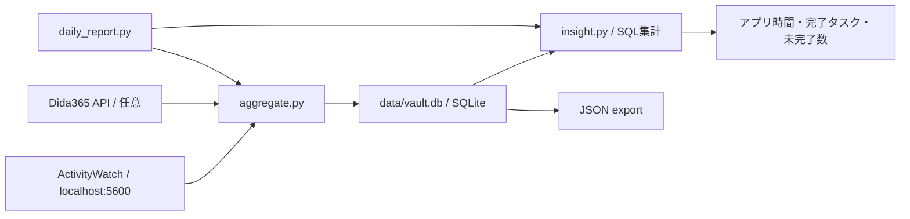

# Personal Data Vault：ActivityWatchとタスクを振り返りへつなぐ小規模実装

2026-10-11調査。対象: [RayR-audit/personal-data-vault](https://github.com/RayR-audit/personal-data-vault)、commit `e63ee7a6991a8f2935fe1285dec4977c0072f53a`。公開コードの静的確認であり、実アカウントへの接続・動作試験はしていない。

関連: [全体アーキテクチャ](architecture.md)、[生活観測設計](personal-observability-design.md)、[ActivityWatch等の調査・アノテーション仮説](aurboda-data-sources-research.md)。

## 位置づけ

ActivityWatchとタスクサービスからデータを取り込み、ローカルSQLiteをSQL集計して日次レポートにするPythonの小規模プロトタイプ。生活データの所有と、収集した記録を見返すきっかけを作る点が参考になる。AurbodaやTimelinizeのような広いデータモデルの参考というより、少数ソースから日常で読める出力までつなぐ最小構成の例として扱う。

READMEの構想にはチャット、AI洞察、JSON/CSV出力もあるが、確認した実装は以下の範囲。[README][readme]。

## コードで確認した構成

| 対象          | 実装と保持するデータ                                                                                         | 制約                                                                                                                           |
| ------------- | ------------------------------------------------------------------------------------------------------------ | ------------------------------------------------------------------------------------------------------------------------------ |
| ActivityWatch | `currentwindow`・`afkstatus` bucketをREST取得。`app_events`にsource、bucket、timestamp、duration、app、title | 元event ID、bucket metadata、元JSONを保存しない。AFKは`not-afk`だけを`app='(active)'`に変換                                    |
| タスク        | Dida365のproject一覧とproject dataを取得。`tasks`に外部ID、title、project名、status、completed_at            | 投稿ではTickTickと説明されるが、コードの接続先は`open.dida365.com`。一般のTickTickアカウント互換性や完了履歴の取得範囲は未検証 |
| 同期          | 既定7日を再取得し、`sync_log`へ件数等を記録                                                                  | 永続cursor・改訂履歴・明確な収集範囲モデルはない                                                                               |
| レポート      | `insight.py`がアプリ別時間、完了タスク数、未完了数、not-afk比率をSQL集計して標準出力                         | LLM・VLM呼び出しはなく、AIによる説明生成は将来扱い                                                                             |
| 日次実行      | `daily_report.py`が同期と集計を順に実行                                                                      | Windowsの固定パス`D:/HermesData/projects/personal-data-vault`。スケジューラーの導入までをこのスクリプトが行うわけではない      |
| Export        | `app_events`と`tasks`をJSONへ書き出す                                                                        | CSVは未実装。ソース原本の完全なexportでもない                                                                                  |

出典: [aggregate.py][aggregate]、[insight.py][insight]、[daily_report.py][daily]。

SQLiteへの保存と集計はローカルだが、タスク取得は外部サービスへの通信を伴う。Dida365連携は`curl.exe`と固定IP解決を使っており、そのままLinuxの収集workerへ移植する構成ではない。API token等の取得・使用は今回行っていない。

## そのまま採用しない点

以下はコードから読み取れる挙動であり、実測した不具合報告ではない。

- **既存記録が更新されない**：AWとタスクの保存が`INSERT OR IGNORE`。AWの同じ開始時刻のduration延長、取り込み済みタスクのopen→completedやタイトル変更が反映されない。Workspaceではソース固有IDによる更新と、取得した版の保存を扱う。[aggregate.py][aggregate]
- **windowとnot-afkの時間を混ぜている**：両方を同じ`app_events`へ入れ、レポートが区別せずSUMするため、同時刻の観測が重複する。さらに表示上位15件の合計をtotalとしている。WorkspaceではwindowとAFKを別の区間として保持し、指標ごとにintersection等を定義する。[insight.py][insight]
- **同期の成功が判別しづらい**：件数は実際のinsert件数ではなく候補行数。失敗を捕捉して0件として処理を続ける経路があり、0件と取得失敗を区別できない。Workspaceでは受領件数・更新件数・失敗・未収集範囲を別に持つ。[aggregate.py][aggregate]
- **原本への参照と再解釈が弱い**：選択された列しか残らず、会話・注釈・複数ソースの根拠を結ぶモデルもない。生活全体のトレースには原記録、型付きモデル、解釈を分ける設計を継続する。

## Redditの議論

参照: [Do you actually look back at your ActivityWatch data?](https://www.reddit.com/r/ActivityWatch/comments/1wf86wg/do_you_actually_look_back_at_your_activitywatch/)。共有URLのchallenge/token等のクエリは保存せず、投稿の恒久URLを使う。

投稿者は数か月分のAW記録をあまり見返していないことを動機に、AWとタスクをSQLiteへ集約して日次レポートを作ったと説明している。AIによる洞察への支払い意向も質問しているが、この投稿だけから需要・継続率・効果は判断できない。

コメントには、TaskwarriorとObsidianを使い、ローカルLLMでAW記録を分類して関連タスクや日次ノートへ反映しているという自己申告がある。実装・分類精度は未確認。AWのUXやクラッシュへの不満もあるが、返信でaw-server-rustの使用が明かされ、別の利用者から異なる安定性の経験も述べられている。AW全体の品質評価には一般化しない。

## Personal Workspaceへ取り入れる示唆

1. **収集と、見返す場面を一緒に作る**。最初のAW取り込みと同時に「昨日の行動・取り組んだ用事・再開する場所」を確認できる小さな出力を用意する。
2. **タスクと観測を照合する**。既存Focus・audit・会話の参照を使い、アプリ時間から直接タスク完了や集中を断定しない。推定結果には根拠を残す。
3. **集計はSQL等で行い、外部AIは説明・提案を担当する**。AIが説明する前に、時間の重複、欠測、日境界、更新の扱いを確定する。
4. **振り返りから返信・実行支援へつなぐ**。記録を読ませるだけでなく、関連する返信案・次の行動・作業再開の文脈を提示できるようにする。ただし振り返りだけの利用も成立させる。

ライセンスは[MIT][license]。設計の参考として追加するもので、今回コードの取り込みは行っていない。

[readme]: https://github.com/RayR-audit/personal-data-vault/blob/e63ee7a6991a8f2935fe1285dec4977c0072f53a/README.md
[aggregate]: https://github.com/RayR-audit/personal-data-vault/blob/e63ee7a6991a8f2935fe1285dec4977c0072f53a/aggregate.py
[insight]: https://github.com/RayR-audit/personal-data-vault/blob/e63ee7a6991a8f2935fe1285dec4977c0072f53a/insight.py
[daily]: https://github.com/RayR-audit/personal-data-vault/blob/e63ee7a6991a8f2935fe1285dec4977c0072f53a/daily_report.py
[license]: https://github.com/RayR-audit/personal-data-vault/blob/e63ee7a6991a8f2935fe1285dec4977c0072f53a/LICENSE
