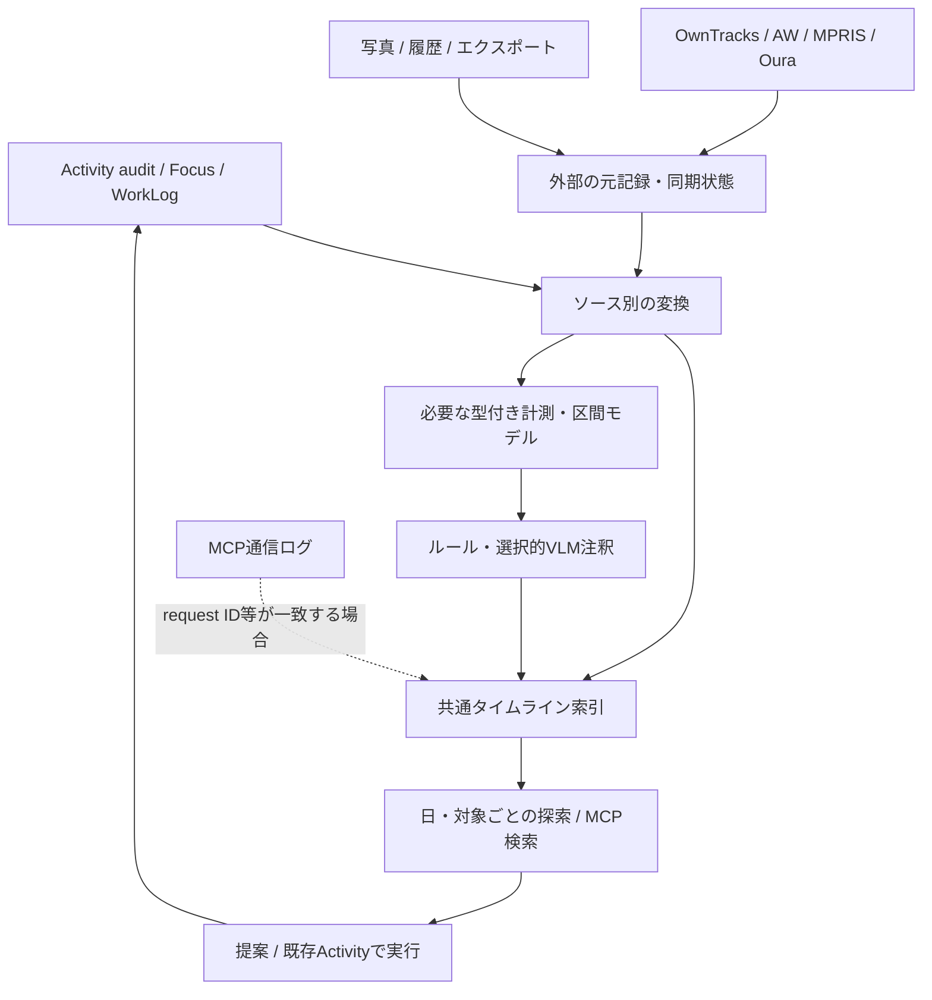

# Personal Workspaceの生活観測・履歴・実行を統合する設計案

2026-10-11。状態: **Proposed（検討案、未実装）**。
Personal Workspaceの確認対象: `07ed2dfe860e6314fb77122a7b20711a0441d1dd`。
Aurboda: `257fa0a5d68fc5012fdec5dce76744b5a2149bcd`、Timelinize: `11ecc5af75a5b0e0250c6197eb213e2b2b7f7c7d`。
公式資料と上記コードの静的調査に基づく。稼働環境のデータ量・遅延・収集品質は未計測。

関連: [Aurboda調査](aurboda-data-sources-research.md)、[Timelinize調査](timelinize-research.md)、[実装済みaudit契約](activity-audit-and-numbers.md)。

追加設計: [Codex・ChatGPT会話の収集とgbrain/Renshengとの境界](ai-conversation-ingestion-design.md)。hookの永続キュー、元記録と会話projection、全量保存の限界、選択移植の方針を整理した。

## 提案の要点

追加参考: [Personal Data VaultとRedditの振り返り事例](personal-data-vault-research.md)。AW＋タスクをSQLiteで集計する小規模実装。収集と日次の利用場面を一緒に作る発想を参考にし、同期更新・重複時間・原本保持の制約を区別する。

全体方針は[ビジョンとアーキテクチャ](architecture.md)を参照。生活全体のトレースを中核に置き、改善・実行に加えて記憶の検索、経緯の理解、文脈の引き継ぎも目的に含める。本書はそのうち観測・audit・分析の詳細設計を扱う。

Personal Workspaceに、Aurbodaの計測・区間分析とTimelinizeのアーカイブ・人物関係・探索を組み合わせる。既存のタスク・返信・Focus・audit logを、本人の意図と実行についてのデータソースとして接続する。

**共通化するのは、時間・対象・来歴・検索の入口。原本の保存方式と意味は用途ごとに保持する。**

既存auditを汎用センサー台帳へ変更せず、監査行を根拠に生活タイムライン用の派生データを作る。最初は既存SQLiteと小さな変換処理で始める。OpenTelemetry、別のメッセージブローカー、グラフDB、全面的なevent sourcingは初期構成に追加しない。

目指す体験は「昨日どのアプリを使ったか」に加えて、「何をするつもりで、何が観測され、AIが何を提案し、本人がどう変更し、その後どうなったか」を一つの画面でたどれること。

既存のlife/Rensheng方針も維持する。人物・組織・関係・約束等の文脈の正本はlifeに置く構想であり、Timelinizeを参考にしたSQLite索引を第二のCRM正本にしない。推論・life編集は外部エージェント、アプリは観測・検索・構造化結果の受け取りと実行状態を担う。life連携自体は未実装。[現在の方向性](architecture.md)。

## 調査で確認したこと

| 対象               | コードで確認した設計                                                                                      | 採用したい点・そのまま移さない点                                                            |
| ------------------ | --------------------------------------------------------------------------------------------------------- | ------------------------------------------------------------------------------------------- |
| Aurboda            | 数値、PC利用、活動、位置等を別の保存モデルで扱う。ActivityWatchを利用区間へ変換し、分類から活動区間を生成 | 型付きの分析モデルと共通表示を両立。全データを汎用JSONだけで集計しない                      |
| Aurbodaの推定      | 条件の時間区間を交差させ、近接区間の統合、活動生成・属性補足・再分類を行う                                | 決定論的な区間処理を先に用意。ただし分類結果は本人の行動の正解とは限らない                  |
| Aurbodaのraw保存   | 同一source/type/external IDの再取得では`data`を更新する                                                   | 「raw」という名前でも全改訂履歴ではない。こちらでは変更される記録の旧版を残す範囲を明示する |
| Timelinize         | Item/Entity/Relationshipを共通の取り込みモデルにし、SQLiteとファイルへ保存                                | 時刻の不確実性、人物照合、関係・来歴の参照。全機能の移植はしない                            |
| TimelinizeのAI     | SigLIP2による画像・文章の埋め込み、検索・分類                                                             | 検索用埋め込みと、行動を説明するVLM注釈を分ける                                             |
| Personal Workspace | SQLite＋Drizzle、変更と同一transactionでaudit保存。MCP通信履歴は別表                                      | 実行の履歴を観測へ接続できる土台が既にある                                                  |

根拠: [AurbodaのAW変換][aw]、[区間化][spans]、[導出エンジン][deduction]、[raw更新][raw]、[Timelinizeモデル][graph]、[Python処理][ml]、[Workspace DB](../src/features/storage/database.server.ts)、[変更transaction](../src/features/activities/repository.server.ts)。

## audit logが示すものと、示さないもの

現在の`activity_audit`にはactor、channel、operation、request ID、revision、時刻、before/afterがある。`requestId + activityId`は一意で、状態が変化しなければauditを追加しない。snapshotはFocus・WorkLog・見積もり・本人の編集・assessmentも含む。[schema](../src/features/storage/schema.ts)、[audit処理](../src/features/activities/audit.server.ts)。

`communication_logs`はMCP書き込みとMCP Eventsの通信試行を保存する。読み取り呼び出しを記録しないのは本人の選択であり維持する。通信ログは保存失敗があり得るbest effort、本文は秘匿化・長さ制限がある。全入力の完全な原本や、必ず届くイベントバスとして使わない。[通信処理](../src/features/activities/communication.server.ts)、[audit契約](activity-audit-and-numbers.md)。

MCP Eventsのoutboxも、購読ごとの配信対象を保持する仕組みであり、全変更の原本ではない。生活履歴の再構築はauditから行う。またVitals・Journalの身体記録とルーティンは現状prototypeであり、永続的な健康データ収集が既にあるとは扱わない。[イベント実装](../src/features/mcp-events/events.server.ts)、[現行機能](../README.md#workspaces-and-current-status)。

| 記録例                   | 確実に言える範囲                         | 生活モデル上の扱い                                       |
| ------------------------ | ---------------------------------------- | -------------------------------------------------------- |
| 本人が`completed`へ変更  | アプリ上の完了状態を本人が登録した       | 完了の自己申告。実際の完了時刻は別に申告されなければ不明 |
| agentが`completed`へ変更 | agentがその変更をcommitした              | agentの判定。assessmentと証拠へリンク                    |
| Focus開始・停止          | タイマーが操作され、その状態が保存された | 本人の意図・タイマー区間。集中の検出結果ではない         |
| 手動WorkLog              | 指定日にその時間を作業したとの記録       | 自己申告。正確な開始時刻がなければ日付精度で表示         |
| MCP write成功            | ツール処理の結果が記録された             | 実行基盤の操作。変更がなければauditがないことも正常      |
| MCP Events配信成功       | 受信先が通信を受け付けた                 | 人が見た・提案を受け入れた・行動したことは示さない       |
| AWでエディタが前面       | watcherがその状態を記録した              | 対象タスクの実行や集中は追加の推定                       |

auditの導入前に起きた変更は復元しない。現在のタスク状態を初期取り込みする場合は「その時点のsnapshot」とし、過去の遷移を捏造しない。read marker、day-plan選択、timer tickは現契約でaudit対象外なので、過去の閲覧・採用率は算出できない。

## アーキテクチャ



原本、正規化された読み取りモデル、訂正可能な解釈の3層を分ける。統合UIはPersonal Workspaceに置き、機器側の収集は既存アプリへ任せられる。派生モデルの遅延・失敗によって、既存のタスク変更を失敗させない。

## データモデル：最小実装と拡張を分ける

最初のPRは既存表から必要期間を読み、純粋な差分変換で返す方式でよい。以下は永続化する場合の論理モデル。外部ソースとの統合や集計で必要になったら`timeline_entries`と`projection_cursors`を導入し、外部の元記録は`source_records`へ置く。身体データやメディアが入る前に、そのための全表を用意しない。

| 層                 | 最初に保持するもの                                                                           | 拡張する契機                                  |
| ------------------ | -------------------------------------------------------------------------------------------- | --------------------------------------------- |
| 既存の原本         | `activity_audit`、Focus、WorkLog、通信ログを保持                                             | 現行の保証・保持方針は変更しない              |
| 外部の元記録       | source、account/device、record type、外部ID、版、取得時刻、元payload、hash                   | AW/MPRIS/OwnTracksの最初の取り込み            |
| タイムライン索引   | 安定ID、kind、対象参照、発生時刻/終了時刻/時間精度、記録時刻、原本参照、変換版、短い表示情報 | auditから開始。巨大なbefore/afterは複製しない |
| 計測値             | metric名、値、単位、時間、端末・ソース・元記録参照                                           | Oura/体重/血圧等を取り込むとき                |
| 行動区間 `Episode` | 区間、分類、構成記録、生成方法                                                               | PC利用をまとめ、Focusと比較するとき           |
| 注釈               | claim、対象、根拠参照、方法/モデル/プロンプト版、生成時刻、訂正・失効状態                    | VLMやルールで意味を補うとき                   |
| 関係               | `supports`、`derived_from`、`about`、`supersedes`等                                          | 複数の根拠や対象間リンクが必要になった段階    |

既存`Activity`はタスク・返信の意図/実行モデルを維持する。観測された行動区間は`Episode`等の別名にし、タスク完了と観測の分類を同じstateへ押し込まない。

観測の種類は`measured / reported / inferred / planned / system_recorded`等で表現する案。ただし「システムが記録した自己申告」のように二つの性質が共存するため、記録方法と主張の根拠を別フィールドにする。confidenceを共通の校正済み確率と見なさず、未校正ならその旨を保持する。

時刻はUTCの基準値に加え、元のoffset/zoneと精度を保持する。継続区間、日付しかない申告、時刻の不確実範囲を区別する。遅れて届いた位置情報を受信時刻へ並べ替えず、発生時刻と受信時刻を両方参照可能にする。

例（フィールド名は提案）:

```json
{
  "id": "audit:842:state-change",
  "kind": "intent.state_changed",
  "subject": { "kind": "activity", "id": "activity_example" },
  "sourceRef": { "kind": "activity_audit", "id": 842 },
  "recordingMethod": "system_recorded",
  "claimBasis": "self_reported",
  "actor": "user",
  "requestId": "request_example",
  "summary": "本人が完了を登録",
  "projectionVersion": 1
}
```

この例に時刻は省略したが、実際にはauditの変更時刻を持つ。「実際に完了した時刻」という値は追加で観測・申告されない限り作らない。

## auditからの変換と二重計上防止

最初は期間指定の読み取りサービスで変換する。次の手順は、索引を永続化するときの契約。初回表示だけのためにバックグラウンド基盤を先に作らない。

1. 内部workerが`activity_audit.id > cursor`を昇順に読む。公開APIの`beforeId`は履歴閲覧用なので、内部処理では別の昇順クエリを使う。
2. before/afterを比較し、状態変更、見積もり変更、本人の修正、Focus操作等へ分類。1audit行から複数の表示項目を出す場合は`audit ID + field/subrecord ID`で安定IDを作る。
3. entriesのupsertとcursor更新を同一transactionでcommit。クラッシュ時は同じ範囲を再処理し、欠落・二重生成を防ぐ。cursorは発生時刻ではなく単調なaudit ID。
4. 変換できない行ではcursorを黙って進めない。失敗対象と処理遅延を表示し、修正後に再実行する。大量の並列workerは初期には不要。
5. 変換版を変えたら、範囲を指定して再構築する。消えた派生項目も除去/失効し、古い分類を残さない。本人の訂正は派生表の上書きで消さず別に保持する。

auditは変更ごとにFocus・WorkLogのsnapshotも含む。その全配列を毎回新しい作業として取り込まない。session ID / work-log IDで差分と最新状態を管理する。削除されたWorkLogもauditには残るが、現在の集計からは除く。

タイマー由来WorkLogは`focusSessionId`で結び付くため、Focus時間とWorkLog時間を加算しない。AW・MPRISも同時に存在し得る別の観測であり、全レーンの長さを「作業時間」として足さない。必要な指標は、union、intersection、ソース優先順位を指定して定義する。画面の前面時間をWorkLogへ自動転記しない。

期間指定では「変更が記録された日」と「対象の活動日」を分ける。変更タイムラインはauditの`occurredAt`、当日の作業集計は現行WorkLogの`occurredOn`とFocusの区間重複を使う。期間内のaudit snapshotだけから当日の作業量を復元しない。日跨ぎFocus、翌日に登録した前日のWorkLog、後日の訂正・削除も検証対象にする。継続中の区間は照会時刻までで表示し、pauseを含む経過時間とactive secondsを区別する。

## 外部取り込みで守る契約

| 入力          | 識別と更新                                                 | 最初に確認すること                                                                      |
| ------------- | ---------------------------------------------------------- | --------------------------------------------------------------------------------------- |
| ActivityWatch | device＋bucket＋event ID。継続イベントのduration更新を扱う | 直近区間を再取得し、同じイベントの延長を新規活動にしない。window/AFK/browserを区別      |
| MPRIS JSONL   | device＋play UUID。同じUUIDのcheckpointは累積値            | 各行を別再生として加算しない。ファイル内の順序で更新し、byte offsetは保存成功後に進める |
| OwnTracks     | device＋type＋元時刻等。公式payloadを保持                  | 同一時刻だけで異なる端末・メッセージを潰さない。再送と別観測の識別規則を実payloadで検証 |
| Oura等のAPI   | providerのIDと更新情報、同期範囲                           | 後から修正される睡眠等を再取得。別経路の同じ記録と無条件に加算しない                    |
| エクスポート  | ファイル/アーカイブhash＋ソース固有ID                      | 同じファイルの再取り込み、時差、添付、元の場所の参照                                    |

共通処理は「同一内容の再送は重複排除、同一記録の変更は版として保存」。内容hashだけを全改訂の一意キーにするとA→B→Aという訂正を失うため、source revisionか取り込み側の順序を持つ。提供元に更新順序がない場合は、受信順を実際の改訂順と断定しない。古いbatchで最新値が巻き戻らないよう、コネクター単位に順序・再同期範囲を定める。

追記ログの末尾の未完行は次回へ持ち越す。ローテーションではファイル世代も識別する。これらは各ソースのアダプターの責務であり、汎用イベントモデルだけでは解決しない。

## 通信ログとの接続：追跡できる範囲だけ結ぶ

`requestId`でMCP writeとauditを結び、`eventId / subscriptionId / attempt`で配送試行をまとめる。複数の配送試行を複数の生活行動にしない。通信の詳細は既存Historyを参照し、生活タイムラインでは既定で折りたたむ。

現状は、外部agentがどの通知を根拠に次のwriteを行ったかを常に識別できるわけではない。近い時刻に起きたから因果関係があるとは扱わない。必要になった段階でwrite入力へ任意の`causedByEventId`と検証済みの根拠参照を追加し、auditに保持する。これはソフトウェア上の処理系列であって、人間の心理・行動の因果推定とは別。

変換処理そのものは読み取りモデルだけを更新し、Activity変更や新しいMCP通知を発生させない。将来agentが観測から提案を出す場合も、根拠と提案の安定ID・既存タスクとの対応を持たせ、同じ観測で提案が増殖する循環を防ぐ。

現在のproposal.sourcesはmessage/life、progress evidenceはbeeper_message/external。初期は既存の参照で表示し、観測から提案を作る段階で`observation`等の型付き参照を追加する。任意の文字列referenceを完全な検証済みリンクとして扱わない。[現在のモデル](../src/features/activities/model.ts)。

## UI・LLM・改善評価

日単位の画面に「意図と変更」「PC・メディア」「場所」「身体」「注釈」をレーンで並べ、元記録とauditへ戻れるようにする。Homeは次の行動を選ぶ画面のままにし、履歴探索は専用画面に置く。正確な時刻が不明な記録は時刻を作らず日付単位で表示する。

LLMには、期間・対象を絞った検索、区間の比較、根拠の取得、訂正可能な注釈の作成を提供する。数値集計はサービス側で実行し、モデルに全ログの暗算をさせない。MCPの読み取りを監査する必要はないが、生成した注釈には入力参照と生成版を保持する。生画像・音声・通信全文を一括でモデルへ渡す設計にはしない。

最初の用途は「昨日の作業の再開」。次に、収納変更や通知設定変更のような介入を、対象Activity・実施記録・前後の観測へ結ぶ。介入の単位は通常のタスクと同一とは限らず、一つの改善実験に複数タスクがあり得る。

提案・提示・採用・実施・結果は別に記録する。現在のauditだけでは「提案を見たが何もしなかった」を判別できないため、提示/採用イベントは介入評価を始める段階で追加する。過去へ補完しない。

評価では作業完了数だけでなく、再開に役立ったか、訂正の手間、通知の負担、収集カバー率を見る。データ欠損を0として扱わない。身体・位置・PCの記録が重なる期間と、本人の主観を併記する。介入前後の差だけで因果効果が実証されたとは言わない。

## 実装順と受け入れ条件

| 単位                    | 成果物                                                                                | 完了と判断する検証                                                                           |
| ----------------------- | ------------------------------------------------------------------------------------- | -------------------------------------------------------------------------------------------- |
| PR 1: auditを生活履歴へ | 既存表の期間クエリ＋純粋なsnapshot差分変換＋日別の最小表示                            | rollbackは出現しない、retryで増えない、WorkLog重複なし、完了登録と実完了を区別、原本へ戻れる |
| PR 2: 最初の外部ソース  | MPRIS JSONLまたは稼働確認済みAWの元記録保存とタイムライン。必要な索引・cursorを永続化 | 同じbatch/ファイルを2回取り込んでも同じ結果、累積値の更新、途中終了から復旧、欠損を表示      |
| PR 3: PC＋意図の照合    | AWのwindow/AFKとFocusの重なり、本人が訂正できるタスク候補                             | 自動的にWorkLogを増やさない、重なりを実行の証明にしない、訂正を再計算後も維持                |
| PR 4: 身体・場所        | OuraとOwnTracksを順次追加、型付き数値と位置の読み取りモデル                           | 遅延到着・更新・単位・日付境界・重複経路、収集停止を区別                                     |
| PR 5: アーカイブ・注釈  | Firefox/写真等の少量取り込み、対象・来歴のリンク、選択的VLM比較                       | 再取り込み、出典への遡及、A/B/C方式の精度とカバー率・費用・訂正負担を比較                    |
| PR 6: 改善の実験        | 提案と提示・採用・実施・結果を結ぶ                                                    | 未提示・未実施・観測欠損を区別、効果不明を表現できる                                         |

「まずデータを貯める」という方針は維持する。OwnTracksの受信設定やOura等の収集開始は、上記PRの完了を待たず進められる。ThinkPadのAW/MPRISは設定を作成したことと実際に稼働・記録できていることを分け、初回取り込み前に稼働を確認する。

第一歩は**既存auditの1日分と外部ログの1日分を、原本へ戻れる共通時間軸に並べること**。大きな分析基盤を先に完成させる必要はない。

コードの配置案は`src/features/observations/`に変換・期間検索・表示モデルを置き、既存`activities/audit.server.ts`の書き込み契約を維持する。初回は全before/afterをLLMへ送らず、フィールド差分と根拠参照を返す。計測の追加時にZodの入力検証と型付き保存を増やす。画面の期間・対象・レーン選択は既存方針どおりURL state、UI文言は英語に揃える。

## 選ばなかった案・残る確認事項

| 案                                        | 今回の判断                                                                                 |
| ----------------------------------------- | ------------------------------------------------------------------------------------------ |
| audit表に全センサー・画像を入れる         | トランザクション保証、本文サイズ、意味が異なる。audit原本と外部記録を分離                  |
| AurbodaとTimelinizeをGitで全面マージ      | 言語・DB・用途が異なる。選択的な参考/移植と上流追跡を続ける                                |
| 全状態をevent sourcingに移行              | 現在のauditは完全なドメインイベントではない。既存CRUD＋再生成可能な読み取りモデルで始める  |
| 先にPostgreSQL/TimescaleDB/グラフDBへ移行 | 実測した書き込み競合・容量・クエリ要件が出てから判断。SQLite継続は将来の規模の保証ではない |
| LLMだけで全記録を解釈                     | 単位・時間・重複・集計は決定論的処理。曖昧な文脈に推論を使う                               |

SQLiteは現状の実装と一致するが、長いインポートtransactionはタスク変更を妨げ得る。小さいbatchで処理し、書き込み待ち・画面応答・DB/WALサイズを実測する。支障が出るなら収集DBを分ける。その場合は原本とcursorを跨ぐtransactionを仮定せず、再送＋冪等な取り込みを維持する。

既存auditの無期限保持と、将来の画像・位置の保持方針は別。原本を削除した場合は関連注釈の根拠が失われたことを表示する。権限を持つ元記録へのリンクでも、モデルへの開示範囲は用途別に絞る。

上流コードの直接移植は次節の方針に従う。今回の設計では第三者の実装コードをコピーしていない。全機能の完成度やVLMの優位性はまだ未検証であり、上記受け入れ条件で小さく確認していく。

## ライセンスと取り込み方針

### 確認したライセンスと現プロジェクトの状態

| 対象                 | 確認結果                                                                                                | 取り込み時の扱い                                                                                      |
| -------------------- | ------------------------------------------------------------------------------------------------------- | ----------------------------------------------------------------------------------------------------- |
| Aurboda              | LICENSEはGNU AGPL v3本文、root package.jsonは`AGPL-3.0-or-later`                                        | 個別ファイル・依存物の表示も確認し、対象commitを固定する                                              |
| Timelinize           | LICENSEはGNU AGPL v3本文、調べたGoファイルのヘッダーはv3または後の版を許諾                              | Go→TypeScriptへの翻訳もコードの移植として扱う。言語変更で出典を消さない                               |
| Personal Workspace   | root LICENSEとroot package.jsonのlicenseフィールドは確認できず、`private: true`は存在                   | 公開・配布ライセンスは未確定として扱う。`private`はnpm誤公開防止の設定で、OSSライセンスの宣言ではない |
| 同梱・依存する別作品 | 例: `runtime/vendor/symphony/LICENSE`が存在。Timelinizeの位置簡略化コードには別実装からの借用表示もある | rootのAGPL表示だけで全依存物の条件を判断しない。コピーするコード・テスト・資産ごとに来歴を残す        |

根拠: [Aurboda LICENSE][aurboda-license]、[package.json][aurboda-package]、[Timelinize LICENSE][timelinize-license]、[Goヘッダー][graph]、[位置簡略化の来歴][simplify]、[Workspace package.json](../package.json)。全依存物のライセンス監査を完了したという意味ではない。

AGPL本文上、コピーの配布では著作権・ライセンス等の表示、改変版では変更の表示などが必要になる（4〜6節）。改変版をネットワーク越しに利用するユーザーには、その版のCorresponding Sourceを無償で取得できる機会を目立つ形で提供する条件がある（13節）。「ネットワーク利用なら無条件に世界全体へ公開」「個人サーバーなら常に義務がない」のどちらとも扱わない。[ライセンス本文][timelinize-license]。

ソース提供の対象と、個人の写真・位置・健康記録、認証情報は分ける。2節は実行結果が内容上covered workを構成する場合に限りその出力に適用すると定めており、利用者データを一律公開するという条件ではない。一方、必要なビルド・導入用ソースの範囲はCorresponding Sourceの定義に従って確認する。具体的な結合作品の範囲はこのメモでは法的に確定しない。[ライセンス本文][timelinize-license]。

### 取り込みアプローチの比較

| 方法                           | 技術的な特徴                                                            | 採用方針・ライセンス上の注意                                                                                                     |
| ------------------------------ | ----------------------------------------------------------------------- | -------------------------------------------------------------------------------------------------------------------------------- |
| 設計・仕様を参考に独自実装     | 現在のSQLite・Activity・MCPに合わせやすい。実装とテストを自分たちで維持 | **新しい共通モデル、audit投影、UIはこれを基本にする**。読んだコードを逐語的に翻訳・再構成して「独自」と称さない                  |
| コネクターや純粋関数を選択移植 | 既存の変換・単位処理・境界条件を活用できる                              | **価値のある小単位に限定して候補化**。コードだけでなくテストも対象。表示・ライセンス・上流追跡を保持し、結合先との適合を先に確認 |
| 別サービスとして稼働しAPI連携  | 大量のコネクター、解析、アーカイブをまとめて再利用できる                | DB依存の移植量が大きい場合の代替。プロセスが別というだけで法的に独立と断定しない。通信の内容・結合の実態で検討                   |
| フォークして継続追従           | 元の製品を使いつつ少数の拡張を維持しやすい                              | 専用インポーター追加等には適する。Personal Workspaceへ全面吸収するためのforkにはしない                                           |
| 全リポジトリmerge / subtree    | ソースは手元に揃うが、Go/TS、DB、UI、リリース責務は残る                 | 初期には採用しない。Git上の統合を製品統合やライセンス解決と混同しない                                                            |

別プロジェクトのAPIから自身の記録を読むことと、そのソースコードを組み込むことは異なる。ライセンス適用を避けるためだけの形式的なサービス分割は方針にしない。AGPLコードを直接統合する場合は、Personal Workspace側の提供形態と、結合部分を含むライセンス方針を先に決める。

### 機能ごとの推奨

| 機能                                        | 方針                                                                                                     |
| ------------------------------------------- | -------------------------------------------------------------------------------------------------------- |
| audit→生活タイムライン、Focus/WorkLogの照合 | 既存の契約に合わせて独自実装。AurbodaのActivityを持ち込まない                                            |
| AurbodaのAW/MPRIS/Oura等の変換              | プロトコル・単位・再同期規則を研究し、小さい純粋変換とテストの移植可否を評価。PostgreSQL層ごとは移さない |
| Aurbodaの区間演算                           | 必要なintersection/unionから実装。高度なrule engine全体は具体的な2つ目の用途が出てから検討               |
| Timelinizeの時刻・来歴・関係モデル          | 必要な概念を採用。Go structや全SQL schemaをそのまま移植しない                                            |
| Timelinizeの多数のアーカイブインポーター    | まず評価用の独立インスタンスで取り込みを試す。多数必要なら外部連携を再評価し、Goの移植を大量に抱えない   |
| Timelinizeの埋め込み・分類                  | 自前VLM注釈とは別用途。今すぐPython推論基盤を同梱せず、検索の要件が出た段階で比較                        |

### 上流追従の運用案

直接移植を選ぶときは、そのPRで`docs/upstream-imports.md`等の台帳を作り、以下を1単位ずつ記録する。現時点では実コードの移植がないので空のvendorディレクトリや台帳は作らない。

- upstream URL、commit、元ファイル・テスト、ライセンス/著作権表示、移植先。
- 変更理由、削った依存、独自仕様、対応していない入力形式。
- 移植元と同じ入力に対する出力比較、ローカル仕様で差が出るfixture。
- 最終確認commit、追従するファイル/依存物、更新時の検証方法。

少数ファイルなら対象パスのupstream diffを確認して手動適用する。`cherry-pick`は共通の履歴・構成を保てるforkでのみ期待し、移植先で大きく変形したコードへ自動マージできる前提を置かない。修正時は正常例だけでなく、単位・時差・重複・訂正・欠損のfixtureで比較する。API破壊変更とセキュリティ修正は定期確認を待たず扱う。

別サービス案を採る場合もversion/commitを固定し、公開API経由のcontract testで更新を検証する。内部DBへの直接結合を既定にせず、上流更新をアダプターで吸収できる境界を保つ。

Timelinizeへ貢献する場合、CONTRIBUTINGはAI利用の開示、ローカル処理、フロントエンドのフレームワーク/ビルド工程を増やさないこと等を求めている。Personal WorkspaceのUIをそのまま上流へ持ち込むより、インポーター修正や汎用バグ修正を候補にする。大きな変更は先に上流で相談する方針。[CONTRIBUTING][contributing]。

以上は採用判断の材料。今回追加したのは設計メモだけで、プロジェクトのライセンス変更、AGPL実装の移植、外部サービスの配備はしていない。

[aw]: https://github.com/fiddur/aurboda/blob/257fa0a5d68fc5012fdec5dce76744b5a2149bcd/apps/backend/src/integrations/activitywatch/sync.ts
[spans]: https://github.com/fiddur/aurboda/blob/257fa0a5d68fc5012fdec5dce76744b5a2149bcd/apps/backend/src/services/screentime-activities.ts
[deduction]: https://github.com/fiddur/aurboda/blob/257fa0a5d68fc5012fdec5dce76744b5a2149bcd/apps/backend/src/services/deduction-engine.ts
[raw]: https://github.com/fiddur/aurboda/blob/257fa0a5d68fc5012fdec5dce76744b5a2149bcd/apps/backend/src/db/raw-records.ts
[graph]: https://github.com/timelinize/timelinize/blob/11ecc5af75a5b0e0250c6197eb213e2b2b7f7c7d/timeline/graph.go
[ml]: https://github.com/timelinize/timelinize/blob/11ecc5af75a5b0e0250c6197eb213e2b2b7f7c7d/tlzapp/python/server/server.py
[aurboda-license]: https://github.com/fiddur/aurboda/blob/257fa0a5d68fc5012fdec5dce76744b5a2149bcd/LICENSE
[aurboda-package]: https://github.com/fiddur/aurboda/blob/257fa0a5d68fc5012fdec5dce76744b5a2149bcd/package.json
[timelinize-license]: https://github.com/timelinize/timelinize/blob/11ecc5af75a5b0e0250c6197eb213e2b2b7f7c7d/LICENSE
[simplify]: https://github.com/timelinize/timelinize/blob/11ecc5af75a5b0e0250c6197eb213e2b2b7f7c7d/datasources/googlelocation/simplify.go
[contributing]: https://github.com/timelinize/timelinize/blob/11ecc5af75a5b0e0250c6197eb213e2b2b7f7c7d/CONTRIBUTING.md
