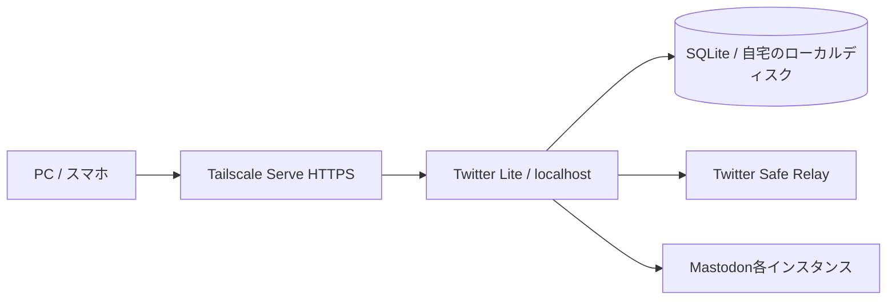

# Mastodon複数アカウント・デッキ端末間共有の実装計画

状態: 機能実装・検証済み。2026-09-24に現行コード・公式仕様・Elkを調査。Drizzle ORM 0.45.3＋Drizzle Kit 0.31.11＋better-sqlite3 13.0.3と、Tailscale Serveの本人情報による利用制限を採用。実機確認の範囲と運用上の引き継ぎは以下に記録する。

## 実装・検証記録（2026-09-24）

- T0〜T6の機能を実装。ユーザーのブラウザでTailscale経由のMastodon認可・callback復帰を確認。
- サーバーはタグ付き端末なので、本人loginはSelf.UserIDから推測せず実際のユーザー情報で設定。タグ付き端末からの本人情報なしアクセスは引き続き拒否。
- 単体・統合202件、Playwrightの共有デッキ／WebMCP／アクセス制限38件と接続管理／callback4件を検証。
- 別ブラウザから保存済み認可を再利用し、実Mastodonを20件→40件へページ送り。同じ一時ビューでTwitter20件を取得。ブラウザエラーなし。確認用ビューは永続保存していない。
- Nixパッケージ単体で起動・3マイグレーション・DB書込・バックアップを確認。依存hash更新済み。
- 実アカウントでの接続はMastodon1件。同一インスタンスの複数アカウント・別インスタンス・再接続・解除・401競合・429はテストで検証し、実アカウントを増減させる破壊的試験は行っていない。
- NixOSサービスの実機デプロイは行わず、モジュール・永続ディレクトリ・credential設定と運用手順を用意。試用用devサーバーを稼働。

## 前提と到達点

- 自分専用。自宅の1台でアプリを稼働し、複数の自分の端末からTailscale ServeのHTTPSで利用する。
- 同じデッキにTwitterとMastodonを並べ、各カラムに接続アカウントを固定できる。
- 端末AでOAuth接続とデッキ作成を済ませれば、端末Bでも同じ接続・デッキを使える。
- デッキ定義・カラム順序・接続一覧を共有する。開いているデッキ、スクロール位置、編集中のフォームは端末ローカルとする案。
- AIが調査ごとに作るデッキは一時ビューとして開き、必要なものだけ保存済みデッキにする。一時ビューは端末間共有の対象外。
- 投稿の収集アーカイブ、AIサマリー、オフライン編集、他人との共同編集はこの増分に含めない。

## 推奨構成

SQLiteを採用する案。端末が増えても、各端末がSQLを実行するのではなく、同じアプリサーバーへアクセスする。デッキ設定とOAuth情報の小さな更新には単一サーバーのSQLiteで始められると判断する。DBファイルを端末間コピーしたり、NAS上のファイルを複数サーバーから直接開いたりしない。

| 候補                 | 今回の評価                                                                                                   |
| -------------------- | ------------------------------------------------------------------------------------------------------------ |
| SQLite               | 推奨。別DBサービス不要。ローカルディスク、短いトランザクション、マイグレーション、復元試験を用意する         |
| PostgreSQL           | 複数アプリサーバーや大量の並列収集へ進む時に再評価。現時点では運用対象が増える                               |
| ブラウザDB＋同期基盤 | 採用しない。今回必要なのはオンラインで同じサーバー状態を読むこと。オフライン同期エンジンを導入する必要はない |

SQLiteは同時書き込みが1つという制約がある。複数サーバー・高い書き込み並列度ではclient/server DBを検討する。[SQLiteの用途](https://www.sqlite.org/whentouse.html)

## 認証と保存の境界

アプリの利用許可とSNSアカウントのOAuthを分ける。最初は単一の私用ワークスペースとし、アプリ内のユーザー登録・パスワード管理は作らない。

Tailscale Serveの本人情報を利用する場合は、自分のloginを許可し、バックエンドをlocalhostに束縛する。現在の試用用 `0.0.0.0` 起動を、そのまま本人情報ヘッダーを信頼する本番構成に持ち込まない。タグ付き端末のアクセスには通常のユーザー情報ヘッダーが付かないため、最初の実機確認に含める。Serveからの経路、利用許可、変更リクエストのOrigin検証を共通化する。[Tailscale Serve identity headers](https://tailscale.com/docs/features/tailscale-serve#identity-headers)

OAuth callbackは固定のHTTPS URLにする。認可後に戻る主体はブラウザなので、その端末がtailnetへ到達できる構成を実機検証する。callbackのためにFunnelでアプリ全体を公開する方針は取らない。

## 保存モデル案

| 保存対象                 | 主な内容                                                                                 |
| ------------------------ | ---------------------------------------------------------------------------------------- |
| `decks`                  | ID、名前、revision、更新日時                                                             |
| `deck_columns`           | ID、deck ID、並び順、connection ID、名前、platform固有のsource JSON                      |
| `connections`            | ID、platform、接続先origin、外部アカウントIDまたはrelay profile参照、表示名、接続状態    |
| `connection_credentials` | connection ID、暗号化したアクセストークン、鍵の識別子。通常の接続一覧とは分離            |
| `oauth_apps`             | インスタンスorigin、callback・scope構成、client ID、暗号化したclient secret              |
| `oauth_attempts`         | 短時間有効なstate、開始ブラウザとの束縛、接続先、PKCE verifier、期限、一度限りの消費状態 |

単一利用者なので、この段階ではusers/organizations/roles等のテーブルを作らない。

カラムの現行 `profileName` を `connectionId` へ変更する。Twitterはconnectionにrelay profile名を保持し、トークンは引き続きrelay側で管理する。Mastodonは接続インスタンスoriginと `verify_credentials` のaccount IDで重複を判定する。表示handleを主キーにしない。同じインスタンスに別アカウントを追加でき、再接続時には既存のconnection IDを維持する。

DBには秘密を暗号化して保存し、暗号鍵はDB外の実行時credentialファイルから読む。鍵やtokenをNix store・Git・ブラウザ・SSR payload・WebMCPに含めない。DBと鍵の両方が揃って復元できる手順を用意する。

## PR単位のタスク

| ID  | タスク                           | 依存     | 完了条件                                                                                                                                                                               |
| --- | -------------------------------- | -------- | -------------------------------------------------------------------------------------------------------------------------------------------------------------------------------------- |
| T0  | 実行環境とアクセス経路を固定     | なし     | 本番HTTPS origin/callback候補を決め、PC・スマホから同じ利用者として接続。Serve以外からのヘッダー偽装を許さない構成を確認。対象Mastodonのバージョン・OAuthメタデータも調べる            |
| T1  | SQLiteと永続ディレクトリを導入   | T0       | 現行Node/Nixで動くdriver・migration方式を実証。`StateDirectory`等でDBを永続化。再起動・アプリ更新後も残り、バックアップから復元できる。依存追加時はflakeのpnpm hash更新まで行う        |
| T2  | connectionモデルへTwitterを移行  | T1       | relay profile一覧から接続を作り、カラム・取得・キャッシュ・ページ送りがconnection IDを使う。2つのTwitter接続を混ぜずに並列表示。不明・削除済みの接続はエラーとして残す                 |
| T3  | デッキをサーバー保存し端末間共有 | T1,T2    | PCで作ったデッキが別ブラウザコンテキストに表示。revision競合で上書きを拒否。WebMCPも同じ保存処理を使う。既存localStorageからの明示インポートを提供し、重複取り込みと既存DBの破壊を防ぐ |
| T4  | Mastodon OAuthとトークン保管     | T0,T1,T2 | 接続先登録→認可→callback→本人確認→暗号化保存。同一インスタンス2アカウント・別インスタンス・再接続・解除が動く。拒否/state不一致・期限切れ・再利用を検証                                |
| T5  | Mastodon取得と投稿正規化         | T4       | ユーザー投稿・リスト・ハッシュタグのカラムを実装し、全文検索を別の能力として扱う。CW・sensitiveメディア・boost・HTML本文を安全に表示。元投稿URLと取得インスタンスのローカルIDを区別    |
| T6  | 複数接続UIとWebMCPを統合         | T3,T5    | 接続管理から追加・再接続・解除。カラムは接続に応じたsourceを選べる。Twitter/Mastodonを同じデッキに並べ、AIも接続一覧を発見して作成・取得できる                                         |
| T7  | 2端末・障害・運用の通し検証      | T3,T4,T6 | 端末AのOAuth接続を端末Bで再認可せず利用。編集競合・接続失効・429・再起動・DB復元の検証。UI/API/WebMCP/ログにトークンが出ないことを確認                                                 |

各PRに必要な単体・統合テストを含める。T7までテストを先送りしない。

推奨順序: `T0 → T1 → T2 → T3` で既存Twitterの端末間共有を先に完成。T3とT4は保存モデル確定後に並列作業可能。その後 `T4 → T5 → T6 → T7`。

### T3: 同期の具体的な範囲

- 保存済みデッキはDBを正本にし、クライアントキャッシュへ読み込む。保存中・保存失敗を区別し、サーバーが受理していない編集を「保存済み」と表示しない。
- デッキ単位のrevisionを比較して、名前・カラム・順序を1トランザクションで更新。同じrevisionへの2回目の更新は競合として返す。
- 初期案はフォーカス復帰時と表示中の軽い定期再取得。SSE/WebSocket/CRDTは導入しない。編集中の内容は自動更新で消さず、競合時に再読み込みを案内する。
- 選択中デッキIDは端末ローカル。PCで別デッキを開いたためにスマホの画面まで勝手に切り替わる挙動を避ける。別端末から削除されたデッキを表示中なら、残りのデッキへ移動し通知する。
- `get_deck`等はrevisionを返し、既存デッキを置換する `set_deck` は期待revisionを指定する。投稿読取ツールにはDB内の秘密を含めない。
- localStorageインポートは一度限りの移行機能。DB完成後にlocalStorageへ書き戻す二重運用はしない。

### T3/T6: AIが作る一時ビューと保存

- 一時ビューと保存済みデッキは同じカラム定義・描画・接続参照を使う。別のプラットフォーム抽象や投稿取得経路は作らない。
- AIによる新規作成は既定で一時ビュー。タブ内のメモリで保持し、DBへは書かない。複数の一時ビューを切り替えられ、UIに「一時」と「デッキとして保存」を表示する。再読み込みやタブを閉じると失われることを画面で明示する。
- 保存操作は新規デッキをサーバーに作成する。成功後にその一時ビューを保存済みデッキへ置き換え、他の端末にも見えるようにする。失敗時は一時ビューを残し、再試行できる。二重クリック・同じ保存要求の再送で重複デッキを作らない。
- 保存済みデッキから一時コピーを作って、AIが検索語・カラムを組み替えて試せる。元デッキは変更しない。初期実装では保存先は新規デッキとし、元デッキへのマージ機能は作らない。
- WebMCPは一時ビューの作成・読取・編集・破棄と、明示的な保存を扱う。既存の保存済みデッキ更新には引き続き期待revisionを要求する。ツールの結果は一時か保存済みかを明示し、保存先を推測させない。
- 一時ビューにも通常のカラム数制限と接続の検証を適用する。投稿内容や認証情報の保存は行わず、保存するのは名前・カラム・検索条件等の定義のみ。
- 検証: AIの一時作成でDB件数が増えない、ページ送りできる、複数ビューを切り替えられる、保存後は別ブラウザから取得できる、保存失敗で内容を失わない、保存再送が重複しない、一時コピーの編集で元デッキを変更しない。

### T4: OAuthの具体的な範囲

- 初期対象はMastodon 4.3以降を提案。Authorization Code＋PKCE S256とstateを使い、旧版互換の分岐は作らない。Mastodonはconfidential clientを前提にしているためclient secretも必要。[OAuth仕様](https://docs.joinmastodon.org/spec/oauth/)
- `POST /api/v1/apps`でインスタンスごとに登録。callback・scope構成と合わせて再利用する。[アプリ登録API](https://docs.joinmastodon.org/methods/apps/)
- 閲覧用scopeに絞る。候補は `read:accounts read:statuses read:lists read:search`。実装したカラムのAPI要件と照合する。同一インスタンスへの別アカウント追加は `force_login=true` を使う。[OAuth API](https://docs.joinmastodon.org/methods/oauth/)
- state/verifierは開始ブラウザに束縛し、期限付き・一度限りで検証。token交換と `verify_credentials` はサーバーで実施し、戻り先URLにtokenを含めない。[本人確認API](https://docs.joinmastodon.org/methods/accounts/#verify-account-credentials)
- 接続解除・401からの再接続を実装。通常のMastodon tokenは自動失効しないため、汎用refresh token基盤を先に作らない。[OAuth tokens](https://docs.joinmastodon.org/api/oauth-tokens/)
- 接続先入力をサーバーがfetchするため、origin・DNS解決先・redirectを検証する。初期は設定したインスタンスの許可リストに限定する案。OAuthやページ送りを家のLANへの汎用HTTP転送にしない。

### T5/T6: プラットフォーム抽象化

- 共通化するのはconnection参照、取得結果、エラー、継続ページの境界。全SNSへTwitterのTop/Latestや検索構文を要求しない。
- source schemaはplatformとkindで分岐。MastodonのリストID・アカウントIDは接続インスタンスの文脈を持つ。接続変更時はリストを選び直す。
- 投稿の同一性にはcanonical URIを使い、取得先のローカルstatus IDはAPI操作用に保持する。boostのwrapperと元投稿を区別する。
- HTML本文は許可する要素・URLを制限して処理。CW・sensitiveを初期表示で尊重し、全文を単に既存のtextへ詰めない。
- Mastodonの全文検索はインスタンスの検索環境次第。明示的な検索エラーと正常な空レスポンスを区別する。ただし4.5.3では検索バックエンド無効時も空配列を返すため、0件だけで全文検索への対応可否は判定できない。画面にも検索範囲が接続先の設定に依存することを表示する。[検索API](https://docs.joinmastodon.org/methods/search/)、[4.5.3の検索処理](https://github.com/mastodon/mastodon/blob/v4.5.3/app/services/search_service.rb)
- ホームタイムライン、通知、Streamingは最初のカラムが動いてから別タスク。既存の調査カラムと手動ページ送りを先に完成する。

## Elkから参考にする範囲

調査対象commit: `8a90074fca9f316a0c71f7249b1a31f21829a987`。

- インスタンス別のOAuth app登録・再利用: [server/utils/shared.ts](https://github.com/elk-zone/elk/blob/8a90074fca9f316a0c71f7249b1a31f21829a987/server/utils/shared.ts)
- 認可URLと複数アカウント追加: [server/api/[server]/login.ts](https://github.com/elk-zone/elk/blob/8a90074fca9f316a0c71f7249b1a31f21829a987/server/api/%5Bserver%5D/login.ts)
- アカウント本人確認・インスタンスと表示ドメインの区別: [app/composables/users.ts](https://github.com/elk-zone/elk/blob/8a90074fca9f316a0c71f7249b1a31f21829a987/app/composables/users.ts)

ElkはOAuth app情報をサーバーに持つが、ユーザーtokenはcallback URLを経由してブラウザへ渡し、IndexedDBの `elk-users` に保存する。今回のサーバーtoken保管・端末間同期は別実装にする。[callback](https://github.com/elk-zone/elk/blob/8a90074fca9f316a0c71f7249b1a31f21829a987/server/api/%5Bserver%5D/oauth/%5Borigin%5D.ts)、[ユーザー保存](https://github.com/elk-zone/elk/blob/8a90074fca9f316a0c71f7249b1a31f21829a987/app/plugins/0.setup-users.ts)

Elkのグローバルなcurrent accountの切り替えも、そのままカラムごとの並列取得には使わない。各カラムはconnection IDから独立したリクエスト文脈を得る。[Mastodonクライアント](https://github.com/elk-zone/elk/blob/8a90074fca9f316a0c71f7249b1a31f21829a987/app/composables/masto/masto.ts)

## 後続タスク

- Bluesky: 接続・認可方式を別途調査し、MastodonのOAuth仕様を流用しない。
- Threads: アプリ登録・利用可能な読み取り権限・検索範囲を実機確認してからスコープを決める。
- Nostr: relay集合・署名/鍵の扱いを別に設計し、OAuthに無理に合わせない。
- AIサマリー/並列収集: 投稿snapshotと取得日時・クエリ・接続文脈を保存する別のデータモデルを追加する。今回は設定同期のDBに投稿アーカイブを混ぜない。
